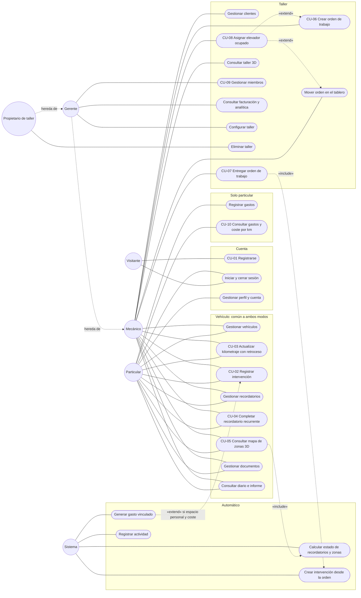

# 2. Casos de uso

*Versión 1 · 21/10/2026 · Autor: agente `documentador-tfg` · Estado: **borrador de análisis** (oleada 1). Basado en el contrato v1; los flujos se verificarán contra la implementación en la oleada 2.*

## 2.1 Actores

| Actor | Tipo | Descripción | Rol técnico |
|-------|------|-------------|-------------|
| **Visitante** | Primario | Persona sin sesión. Puede ver la portada, registrarse e iniciar sesión. | — |
| **Particular** | Primario | Propietario de uno o varios vehículos que lleva su seguimiento en su espacio personal («Mi garaje»). | `owner` de un espacio `personal` |
| **Mecánico** | Primario | Miembro de un taller que opera el día a día: vehículos, órdenes, elevadores, historial, recordatorios y documentos. No ve facturación ni gastos. | `mechanic` en un espacio `workshop` |
| **Gerente** | Primario | Responsable del taller. Hace todo lo del mecánico y además gestiona miembros, ajustes, gastos, facturación y archivado/borrado. | `manager` en un espacio `workshop` |
| **Propietario de taller** | Primario | Dueño del espacio de taller. Hace todo lo del gerente y además puede eliminar el taller. | `owner` en un espacio `workshop` |
| **Sistema** | Secundario | Comportamiento automático del servidor desencadenado por otros casos de uso: gasto vinculado, cálculo de estados, lecturas de km derivadas, intervención al entregar una orden, registro de actividad. | — |

**Generalización.** En un taller las capacidades son acumulativas (`view` ⊂ `operate` ⊂ `manage` ⊂ `own`, contrato §2): el *Gerente* hereda los casos de uso del *Mecánico* y el *Propietario de taller* hereda los del *Gerente*. Una misma persona puede ser *Particular* en su espacio personal y *Mecánico* en un taller con la misma cuenta ([ADR‑0002](../arquitectura/ADR-0002-espacios-de-trabajo.md)).

## 2.2 Diagrama de casos de uso

Notación: los actores se dibujan como círculos y los casos de uso como cápsulas; la línea discontinua «hereda de» representa la generalización entre actores; «include» y «extend» siguen la semántica UML. Los casos de uso con número (CU‑nn) se especifican en §2.4.

*Por legibilidad no se dibuja la asociación de «Iniciar y cerrar sesión» y «Gestionar perfil» con los actores de taller (todos los usuarios registrados la tienen), ni la inclusión de «Registrar actividad» en cada caso de uso de escritura (contrato §3.12).*

## 2.3 Catálogo de casos de uso

| Caso de uso | Actores | Requisitos |
|-------------|---------|------------|
| CU-01 Registrarse | Visitante | RF-03 |
| Iniciar y cerrar sesión | Todos | RF-04, RF-05, RF-06 |
| Gestionar perfil y cuenta | Usuarios registrados | RF-07, RF-08, RF-09, RF-10 |
| Gestionar vehículos | Particular, Mecánico (+ herencia; archivar/eliminar: Gerente) | RF-17…RF-22 |
| CU-03 Actualizar kilometraje con retroceso | Particular, Mecánico | RF-23, RF-24, RF-25, RF-26 |
| CU-02 Registrar intervención (con gasto vinculado) | Particular, Mecánico; Sistema | RF-27…RF-32 |
| Gestionar recordatorios | Particular, Mecánico | RF-41, RF-42, RF-44, RF-45 |
| CU-04 Completar recordatorio recurrente | Particular, Mecánico; Sistema | RF-43 |
| CU-05 Consultar mapa de zonas 3D | Particular, Mecánico; Sistema | RF-46…RF-50 |
| Gestionar documentos | Particular, Mecánico | RF-53…RF-56 |
| Consultar diario e informe | Particular, Mecánico | RF-58, RF-59, RF-60 |
| Registrar gastos | Particular (en taller: Gerente) | RF-33, RF-34, RF-35 |
| CU-10 Consultar gastos y coste por km | Particular | RF-36…RF-39, RF-57 |
| Gestionar clientes | Mecánico (+ herencia; eliminar: Gerente) | RF-61 |
| CU-06 Crear orden de trabajo | Mecánico (+ herencia) | RF-62, RF-67 |
| Mover orden en el tablero | Mecánico (+ herencia) | RF-63, RF-64, RF-68 |
| CU-07 Entregar orden de trabajo | Mecánico (+ herencia); Sistema | RF-64, RF-65 |
| CU-08 Asignar elevador ocupado | Mecánico (+ herencia) | RF-66 |
| Consultar taller 3D | Mecánico (+ herencia) | RF-51, RF-69 |
| CU-09 Gestionar miembros | Gerente, Propietario de taller | RF-15 |
| Consultar facturación y analítica | Gerente, Propietario de taller | RF-40, RF-69 |
| Configurar taller | Gerente, Propietario de taller | RF-12, RF-13 |
| Eliminar taller | Propietario de taller | RF-14 |
| Calcular estado de recordatorios y zonas | Sistema | RF-42, RF-46 |
| Registrar actividad | Sistema | RF-60 |

## 2.4 Especificación de los casos de uso principales

Convenciones: «SPA» es la aplicación React en el navegador; «API» es el backend Laravel. Todas las rutas cuelgan de `/api/v1`. En todos los casos, salvo CU‑01, rigen dos excepciones comunes que no se repiten:

- **E‑401** · Sin sesión o sesión caducada: la API responde 401 y la SPA lleva al login conservando la ruta pedida (RF-06).
- **E‑404** · Recurso de un espacio al que el usuario no pertenece: la API responde 404 sin revelar que existe (RNF-02).

---

### CU-01 · Registrarse

| Campo | Valor |
|-------|-------|
| Actor principal | Visitante |
| Requisitos | RF-03 (y RF-11) |
| Endpoints | `GET /sanctum/csrf-cookie`, `POST /auth/register` |

**Precondiciones.** El visitante no tiene sesión iniciada.

**Flujo principal.**
1. El visitante elige «Crear cuenta» en la portada o en el login.
2. La SPA muestra el formulario: nombre, email, contraseña, confirmación y tipo de cuenta (*Particular* o *Taller*).
3. El visitante elige *Taller* e indica el nombre del taller (si elige *Particular*, este campo no aparece).
4. La SPA valida en cliente, pide `GET /sanctum/csrf-cookie` y envía `POST /auth/register`.
5. La API valida los datos, guarda el usuario (email en minúsculas, contraseña con *hash*), crea su espacio `personal` y, al ser cuenta de taller, un espacio `workshop` con ese nombre, ambos con el usuario como `owner`. Inicia la sesión.
6. La API responde 201 con el usuario y sus espacios (`Me`).
7. La SPA entra en la aplicación y guía al usuario a añadir su primer vehículo.

**Flujos alternativos y excepciones.**
- **3a. Cuenta particular:** solo se crea el espacio personal.
- **5a. Email ya registrado, contraseña corta o sin confirmar, nombre de taller ausente:** 422 con errores por campo; la SPA los muestra junto a cada campo y no se crea nada.
- **5b. Token CSRF caducado:** Laravel responde 419; la SPA debe pedir de nuevo la cookie y reintentar. *El código 419 no figura en el contrato v1; se señala al arquitecto.*

**Postcondiciones.** Existe el usuario con al menos un espacio personal (y, en su caso, uno de taller) y una sesión activa.

---

### CU-02 · Registrar intervención con gasto vinculado

| Campo | Valor |
|-------|-------|
| Actor principal | Particular |
| Actores secundarios | Sistema |
| Requisitos | RF-27, RF-28, RF-29, RF-26 |
| Endpoints | `POST /vehicles/{v}/maintenance` |
| Decisión | [ADR‑0003](../arquitectura/ADR-0003-gasto-vinculado.md) |

**Precondiciones.** El particular tiene sesión; el vehículo pertenece a su espacio personal.

**Flujo principal.**
1. El particular pulsa «Añadir intervención» en la ficha del vehículo (o en los accesos rápidos del dashboard, con el vehículo preseleccionado).
2. La SPA muestra el formulario: tipo, zona, tipo de servicio, título, fecha, km, taller, descripción, costes y líneas.
3. El particular introduce, por ejemplo, «Cambio de aceite y filtro», tipo *mantenimiento*, zona *motor*, servicio *aceite*, fecha y km, y añade dos líneas (aceite y filtro) y una de mano de obra. La SPA propone el total a partir de las líneas y avisa si el total escrito a mano no cuadra con el desglose (E3-2).
4. La SPA valida en cliente y envía `POST /vehicles/{v}/maintenance`.
5. La API valida la petición y comprueba que el usuario puede operar en el espacio del vehículo.
6. En **una única transacción**, la API: crea la intervención y sus líneas (calcula el total de cada línea); registra la lectura de km (`source = maintenance`) aplicando el control de retrocesos y recalcula el km actual del vehículo; como el espacio es personal y `total_cost > 0`, **crea el gasto vinculado** (categoría `maintenance`, misma fecha, km e importe, descripción = título); y registra la actividad `maintenance.created`.
7. La API responde 201 con la intervención, que incluye `expense_id`.
8. La SPA confirma la operación; la intervención aparece en la línea temporal y el gasto aparece en Gastos como «desde intervención», con enlace a ella.

**Flujos alternativos y excepciones.**
- **3a. Sin coste:** si `total_cost` es nulo o 0, en el paso 6 no se crea gasto.
- **3b. Tipo reparación, avería o carrocería:** el gasto se crea con categoría `repair`; si es inspección, `inspection`.
- **5a. Datos no válidos** (título < 2 caracteres, fecha futura, importe negativo o con más de 2 decimales, más de 50 líneas, cantidad ≤ 0): 422 con errores por campo; no se guarda nada.
- **6a. Kilometraje incoherente con otras lecturas:** 422 con `errors.mileage`; la transacción no llega a confirmarse. La SPA pide confirmación y, si el usuario confirma, reenvía con `confirm_mileage_drop: true` (ver CU-03) y se continúa en el paso 6.
- **6b. Fallo durante la transacción:** se revierte completa; nunca queda una intervención sin su gasto ni un gasto huérfano. Respuesta de error genérica sin detalles internos.
- **6c. Espacio de taller:** el mismo caso de uso ejecutado por un mecánico no genera gasto (la cifra económica de un taller es la facturación de órdenes).

**Postcondiciones.** La intervención, sus líneas, la lectura de km (si se indicó) y el gasto vinculado (si hubo coste) existen o no existen **juntos**. El gasto tiene `maintenance_record_id` único, no se puede editar ni borrar desde Gastos (409) y los totales lo cuentan **una sola vez**. Editar el coste actualiza el gasto; archivar la intervención lo elimina y restaurarla lo recrea (RF-32).

---

### CU-03 · Actualizar kilometraje con retroceso

| Campo | Valor |
|-------|-------|
| Actor principal | Particular o Mecánico (y herederos) |
| Requisitos | RF-23, RF-24, RF-25, RF-26 |
| Endpoints | `POST /vehicles/{v}/mileage`, `DELETE /mileage/{log}` |

**Precondiciones.** Sesión iniciada con permiso `operate` en el espacio del vehículo; el vehículo tiene al menos una lectura previa, p. ej. 84.200 km el 12/03/2026.

**Flujo principal.**
1. El usuario pulsa «Actualizar km» en la ficha o el dashboard.
2. La SPA muestra fecha (hoy por defecto) y km.
3. El usuario introduce 48.200 km (quería escribir 84.200 y ha transpuesto cifras, o el vehículo cambió de cuadro de instrumentos).
4. La SPA envía `POST /vehicles/{v}/mileage`.
5. La API valida (entero ≥ 0, fecha no futura) y compara con las lecturas existentes: el nuevo valor es **menor** que una lectura de fecha anterior.
6. La API responde 422 con `errors.mileage`: «El kilometraje no cuadra con lecturas anteriores (último: 84.200 km el 12/03/2026). Confírmalo si es correcto.»
7. La SPA muestra el mensaje junto al campo y ofrece dos acciones: corregir el valor o confirmar que es correcto.
8. El usuario confirma; la SPA reenvía la lectura con `confirm_mileage_drop: true`.
9. La API guarda la lectura (`source = manual`), recalcula `current_mileage` como la lectura **más reciente por fecha** (desempate: mayor km) y registra la actividad `mileage.recorded`.
10. La API responde 201; la SPA actualiza el km mostrado.

**Flujos alternativos y excepciones.**
- **5a. Lectura coherente:** no hay paso 6‑8; la lectura se guarda directamente.
- **5b. Lectura mayor que otra de fecha posterior** (se introduce una lectura antigua con un valor demasiado alto): mismo tratamiento que el retroceso.
- **5c. Fecha futura o km negativo:** 422; no se guarda nada.
- **7a. El usuario corrige el valor:** se vuelve al paso 4 con el valor corregido.
- **9a. Corrección posterior:** si la lectura confirmada era un error, el usuario puede eliminarla (`DELETE /mileage/{log}`, solo lecturas manuales) y el km actual se recalcula.
- **Taller:** el km de entrada de una orden (CU-06) se acepta sin confirmación aunque sea menor, pero se registra igualmente.

**Postcondiciones.** Existe la nueva lectura y el km actual refleja la lectura más reciente por fecha. Los indicadores que dependen del km (coste por km, recordatorios por km, zonas) se recalculan en la siguiente consulta.

---

### CU-04 · Completar recordatorio recurrente

| Campo | Valor |
|-------|-------|
| Actor principal | Particular o Mecánico (y herederos) |
| Actores secundarios | Sistema |
| Requisitos | RF-43, RF-42, RF-26 |
| Endpoints | `POST /reminders/{r}/complete` |

**Precondiciones.** Existe un recordatorio `pending` con recurrencia, p. ej. «Cambio de aceite», cada 12 meses o 15.000 km, en estado `soon` u `overdue`.

**Flujo principal.**
1. El usuario ve el recordatorio en la ficha del vehículo, en la agenda del espacio o en la zona *Motor* del mapa 3D, y pulsa «Marcar como hecho».
2. La SPA pide la fecha (hoy por defecto) y, opcionalmente, el km; la casilla «Crear el siguiente» aparece marcada.
3. La SPA envía `POST /reminders/{r}/complete` con `completed_at`, `mileage` y `create_next`.
4. La API valida y, en una transacción: si llega km, crea una lectura (`source = reminder`) con las reglas de km; marca el recordatorio como `done` con `completed_at` y `completed_mileage`; al haber recurrencia y no venir `create_next = false`, **crea el siguiente** recordatorio con `starts_on = completed_at`, `start_mileage = completed_mileage`, `due_date = completed_at + 12 meses` y `due_mileage = completed_mileage + 15.000`; registra la actividad `reminder.completed`.
5. La API responde 200 con `{ completed, next }`.
6. La SPA confirma y muestra el próximo vencimiento; la zona *Motor* se recalcula con el nuevo recordatorio.

**Flujos alternativos y excepciones.**
- **2a. El usuario desmarca «Crear el siguiente»:** `next` es `null`.
- **4a. Recordatorio sin recurrencia:** se completa y `next` es `null`.
- **4b. Km incoherente:** 422 en `mileage`. *Hueco del contrato:* `CompleteReminderInput` no incluye `confirm_mileage_drop`, así que no está definido cómo confirmar el retroceso en este caso.
- **4c. Recurrencia solo por km y completado sin km:** el siguiente quedaría sin fecha ni km de vencimiento. *Hueco del contrato*, señalado al arquitecto.
- **4d. Recordatorio ya completado o descartado:** el contrato v1 no fija la respuesta (propuesta: 409).

**Postcondiciones.** El recordatorio queda `done` con su fecha y km; si procede, existe uno nuevo `pending` cuyo estado y progreso se calculan al consultarlo («según tus intervalos, no medido»).

---

### CU-05 · Consultar mapa de zonas 3D

| Campo | Valor |
|-------|-------|
| Actor principal | Particular o cualquier miembro del taller |
| Actores secundarios | Sistema |
| Requisitos | RF-46, RF-47, RF-48, RF-49 |
| Endpoints | `GET /vehicles/{v}`, `GET /vehicles/{v}/zones` |
| Decisión | [ADR‑0004](../arquitectura/ADR-0004-vehiculo-3d-procedural.md) |

**Precondiciones.** Sesión iniciada con permiso `view` en el espacio del vehículo.

**Flujo principal.**
1. El usuario abre la ficha del vehículo y pasa al modo de inspección.
2. La SPA pide el vehículo y `GET /vehicles/{v}/zones`; mientras tanto muestra la silueta 2D como marcador de posición.
3. La API calcula, para cada una de las 10 zonas, el peor estado de sus recordatorios pendientes (`overdue` > `soon` > `ok` > `unknown`) y la base del cálculo (`reminders`, `records` o `none`), junto con la última intervención, el nº de registros y el próximo recordatorio. Devuelve siempre las 10 zonas en el orden del enumerado.
4. La SPA carga de forma diferida el módulo 3D y dibuja el vehículo procedural con su carrocería y color; cada zona muestra un punto con su estado (color **más** icono y texto) y la leyenda «según tus intervalos, no medido».
5. El usuario selecciona la zona *Frenos* con el ratón, el dedo o el teclado (desde la lista HTML equivalente).
6. La SPA muestra el panel de la zona: estado y base, última intervención, nº de registros y próximo recordatorio, con accesos a «Ver historial de la zona» (filtro `zone`) y «Crear recordatorio».
7. Opcionalmente, el usuario activa la vista «rayos X», rotulada como ilustración.

**Flujos alternativos y excepciones.**
- **4a. Sin WebGL:** la SPA mantiene la silueta SVG y la lista HTML de zonas con la misma información.
- **4b. `prefers-reduced-motion`:** sin autorrotación ni transiciones de cámara.
- **6a. Zona sin datos (`basis = none`):** el panel lo dice («Sin datos para esta zona») y ofrece crear un recordatorio o registrar una intervención; nunca se muestra un estado inventado.
- **6b. Zona solo con historial (`basis = records`):** se indica que hay intervenciones pero ningún intervalo definido.
- **2a. Error de red:** estado de error con «Reintentar».

**Postcondiciones.** Ninguna (consulta). No se ha mostrado ningún dato que no proceda de recordatorios o intervenciones del usuario.

---

### CU-06 · Crear orden de trabajo

| Campo | Valor |
|-------|-------|
| Actor principal | Mecánico (y herederos) |
| Requisitos | RF-62, RF-67, RF-66, RF-26 |
| Endpoints | `POST /workspaces/{ws}/work-orders`, `GET /workspaces/{ws}/vehicles`, `GET /workspaces/{ws}/bays` |

**Precondiciones.** Sesión con permiso `operate` en un espacio `workshop`; el vehículo está dado de alta en el taller.

**Flujo principal.**
1. El mecánico pulsa «Nueva orden» en el tablero, el dashboard o la ficha del vehículo.
2. La SPA muestra el formulario: vehículo (buscador por matrícula, cliente o modelo), título, síntoma, prioridad, km de entrada, fecha prometida, mecánico asignado, elevador (opcional, con la ocupación actual), IVA (por defecto el del taller) y líneas.
3. El mecánico completa los datos y envía; la SPA llama a `POST /workspaces/{ws}/work-orders`.
4. La API valida: el vehículo es del taller, el asignado es miembro del espacio y el elevador está entre 1 y `bays_count`.
5. En una transacción, la API: obtiene con **bloqueo** el siguiente número `OT-{año}-{nnnn}` del espacio; comprueba que el elevador indicado está libre; crea la orden en estado `received` con `received_at = ahora` y el cliente copiado del vehículo; calcula subtotal, IVA (*half‑up*) y total; si hay km de entrada, crea la lectura (`source = work_order`); registra la actividad `work_order.created`.
6. La API responde 201 con la orden.
7. La SPA la muestra en la columna «Recibido» del tablero y, si tiene elevador, en ese elevador del taller 3D.

**Flujos alternativos y excepciones.**
- **1a. El vehículo no existe en el taller:** el mecánico lo da de alta primero (con su cliente) y vuelve al paso 2.
- **4a. Datos no válidos** (asignado que no es miembro, elevador fuera de rango, líneas no válidas): 422.
- **4b. Vehículo de otro espacio:** se rechaza sin revelar datos del otro espacio. *El contrato v1 no fija el código para `vehicle_id` en el cuerpo (propuesta: 422 en `vehicle_id`).*
- **5a. Elevador ocupado:** 409; se continúa en CU-08.
- **5b. Km de entrada menor que la última lectura:** se acepta sin confirmación y se registra (regla de taller, contrato §3.11).

**Postcondiciones.** Existe la orden con número único y correlativo, en `received`, con sus importes calculados; si se indicó, el elevador queda ocupado y existe la lectura de km.

---

### CU-07 · Entregar orden de trabajo

| Campo | Valor |
|-------|-------|
| Actor principal | Mecánico (y herederos) |
| Actores secundarios | Sistema |
| Requisitos | RF-64, RF-65 |
| Endpoints | `POST /work-orders/{o}/status` |

**Precondiciones.** La orden existe en un estado no final, normalmente `ready` (lista para recoger).

**Flujo principal.**
1. El cliente recoge el vehículo y el mecánico arrastra la tarjeta a «Entregado» (o pulsa «Entregar» en el detalle).
2. La SPA pide confirmación, porque el estado es final y la orden pasará a solo lectura.
3. La SPA envía `POST /work-orders/{o}/status` con `{ status: "delivered" }`.
4. La API comprueba el permiso y, en una transacción con la orden bloqueada: verifica que no está en un estado final; fija `status = delivered` y `delivered_at`; libera el elevador; **crea una intervención** en el historial del vehículo (`type = repair`, `zone = general`, título de la orden, diagnóstico como descripción, fecha de entrega, `mileage = mileage_in`, nombre del taller, `total_cost = total`, líneas copiadas, `work_order_id`); enlaza la orden con ella (`maintenance_record_id`); registra la actividad `work_order.status_changed`. Al ser un taller, no se crea gasto.
5. La API responde 200 con la orden actualizada.
6. La SPA mueve la tarjeta, muestra el enlace a la intervención creada y el elevador aparece libre en el taller 3D.

**Flujos alternativos y excepciones.**
- **2a. El usuario cancela:** no se envía nada.
- **4a. La orden ya estaba `delivered` o `cancelled`:** 409; la SPA recarga el tablero.
- **4b. Entrega desde un estado distinto de `ready`:** el contrato permite el movimiento libre entre estados no finales; en ese caso `completed_at` puede no haberse fijado. *Pendiente de precisar.*
- **4c. Fallo durante la transacción:** se revierte; la orden sigue en su estado anterior y no se crea intervención.

**Postcondiciones.** La orden queda entregada y de solo lectura; el historial del vehículo contiene la intervención con el trabajo realizado; la orden cuenta en la facturación del taller; el elevador está libre.

---

### CU-08 · Asignar elevador ocupado

| Campo | Valor |
|-------|-------|
| Actor principal | Mecánico (y herederos) |
| Requisitos | RF-66 |
| Endpoints | `PATCH /work-orders/{o}` (o `POST /work-orders/{o}/status` con `bay`), `GET /workspaces/{ws}/bays` |

**Precondiciones.** La orden OT-2026-0007 está abierta; el elevador 2 está ocupado por la orden abierta OT-2026-0004.

**Flujo principal.**
1. El mecánico arrastra OT-2026-0007 al elevador 2 en el taller 3D (o elige «Elevador 2» en el detalle).
2. La SPA envía `PATCH /work-orders/{o}` con `{ bay: 2 }`.
3. La API valida el rango y, dentro de la transacción, comprueba que ninguna otra orden abierta del espacio ocupa el elevador 2.
4. La API responde **409**: «El elevador 2 está ocupado por OT-2026-0004».
5. La SPA deshace el movimiento visual, muestra el mensaje y ofrece abrir OT-2026-0004 o elegir un elevador libre (consulta `GET /workspaces/{ws}/bays`).
6. El mecánico elige el elevador 3, que está libre; la SPA envía `PATCH` con `{ bay: 3 }`.
7. La API asigna el elevador y responde 200; la SPA coloca el coche en el elevador 3.

**Flujos alternativos y excepciones.**
- **3a. Elevador libre:** se asigna directamente (pasos 6‑7).
- **3b. Elevador fuera de rango** (mayor que `bays_count`): 422.
- **5a. Liberar primero el elevador:** el mecánico pasa OT-2026-0004 a `ready` (lo que libera el elevador) y repite el paso 2.
- **3c. Concurrencia:** si dos usuarios asignan el mismo elevador a la vez, solo una petición debe tener éxito. Requiere que la comprobación se haga con bloqueo dentro de la transacción; *pendiente de verificar en el backend*.

**Postcondiciones.** Si hubo conflicto, ninguna orden ha cambiado. Al final, cada elevador tiene como mucho una orden abierta.

---

### CU-09 · Gestionar miembros del taller

| Campo | Valor |
|-------|-------|
| Actor principal | Gerente o Propietario de taller |
| Requisitos | RF-15, RF-16 |
| Endpoints | `GET/POST /workspaces/{ws}/members`, `PATCH/DELETE /workspaces/{ws}/members/{user}` |

**Precondiciones.** Sesión con permiso `manage` en un espacio `workshop`. La persona que se quiere añadir ya tiene cuenta en CarCare.

**Flujo principal (añadir).**
1. El gerente abre Ajustes → Equipo; la SPA lista los miembros (`GET …/members`).
2. Pulsa «Añadir miembro», escribe el email y elige el rol (`manager` o `mechanic`).
3. La SPA envía `POST /workspaces/{ws}/members`.
4. La API comprueba `manage`, busca la cuenta por email, la vincula al espacio con el rol elegido y registra `member.added`.
5. La SPA actualiza la lista; el nuevo miembro verá el taller en su selector de espacios.

**Flujos alternativos y excepciones.**
- **4a. Email sin cuenta:** 422 «No existe ninguna cuenta con ese email». (La invitación por email no está en el contrato v1.)
- **4b. Espacio personal:** 409.
- **A1. Cambiar rol:** `PATCH …/members/{user}` con `{ role }` → `member.role_changed`. Si es el último `owner`, 409.
- **A2. Quitar miembro:** `DELETE …/members/{user}` → 204 y `member.removed`. Si es el último `owner`, 409.
- **A3. Salir del taller:** cualquier miembro, incluido el mecánico, puede eliminarse a sí mismo.
- **A4. Un mecánico intenta añadir o cambiar roles:** 403.
- **Pendiente en el contrato:** respuesta si el usuario ya era miembro y si `PATCH` permite promover a `owner` (transferencia de propiedad).

**Postcondiciones.** El espacio conserva siempre al menos un `owner`; cada cambio queda en la actividad.

---

### CU-10 · Consultar gastos y coste por kilómetro

| Campo | Valor |
|-------|-------|
| Actor principal | Particular |
| Requisitos | RF-34, RF-36, RF-37, RF-38, RF-35 |
| Endpoints | `GET /vehicles/{v}/summary?from&to`, `GET /vehicles/{v}/expenses?from&to&category` |

**Precondiciones.** Sesión iniciada; el vehículo pertenece a su espacio personal.

**Flujo principal.**
1. El particular abre «Gastos y analítica» del vehículo.
2. Elige el periodo (mes, trimestre, año o personalizado) y, opcionalmente, categorías; la URL conserva los filtros.
3. La SPA pide el resumen y el listado de gastos con esos filtros.
4. La API calcula **solo a partir de `expenses`**: total del periodo, mes y año; por categoría; serie de 12 meses; comparación con el periodo anterior; coste por km (si en el periodo hay ≥ 2 lecturas separadas ≥ 500 km y ≥ 30 días: total ÷ (km máx − km mín)); consumo lleno‑a‑lleno.
5. La SPA muestra las cifras y los gráficos; cifras y gráficos cambian a la vez al tocar un filtro. Los gastos vinculados aparecen como «desde intervención».

**Flujos alternativos y excepciones.**
- **4a. Datos de km insuficientes:** `cost_per_km.available = false` y `reason` explica qué falta; la SPA lo muestra y ofrece «Actualizar kilometraje» (CU-03). Nunca se muestra una cifra estimada.
- **4b. Periodo anterior sin gastos:** no se muestra comparación (`change_pct = null`).
- **4c. Sin gastos en el periodo:** estado vacío con «Añadir gasto».
- **5a. El usuario intenta editar o borrar un gasto vinculado:** 409; la SPA ofrece ir a la intervención.

**Postcondiciones.** Ninguna (consulta). Todas las cifras proceden de datos persistidos.
