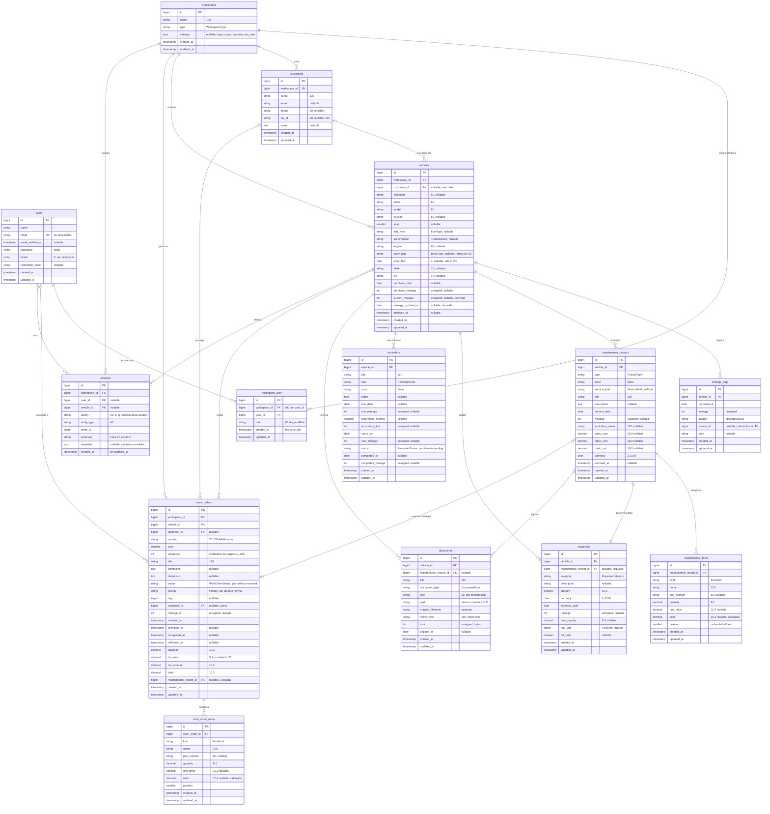

# 3. Modelo de datos

*Versión 1.1 · 21/10/2026 · Autor: agente `documentador-tfg` · Estado: **verificado contra las migraciones** del 21/10/2026 (ver §3.6). Las migraciones pueden cambiar mientras dure la oleada 1; el diagrama se regenerará en la oleada 2.*

> **Fuentes.** Migraciones de `backend/database/migrations/` (fuente principal de este documento), modelos de `backend/app/Models/`, formas JSON de [`frontend/src/api/types.ts`](../../frontend/src/api/types.ts), reglas de [`docs/api/contrato-v1.md`](../api/contrato-v1.md), [ADR‑0002](../arquitectura/ADR-0002-espacios-de-trabajo.md) y [ADR‑0003](../arquitectura/ADR-0003-gasto-vinculado.md).

## 3.1 Diagrama entidad‑relación

Tipos tal como los declaran las migraciones de Laravel (`string` = `VARCHAR`, `bigint` = `BIGINT UNSIGNED` en claves). Los enumerados se guardan como `VARCHAR` y se convierten a *backed enums* de PHP en el modelo (el comentario indica el enumerado).

*No se dibujan las tablas de infraestructura de Laravel (`sessions`, `password_reset_tokens`, `cache`, `cache_locks`, `jobs`, `job_batches`, `failed_jobs`), que no forman parte del dominio. La tabla `sessions` es la que guarda las sesiones de Sanctum en modo SPA.*

## 3.2 Cardinalidades

| Relación | Cardinalidad | Regla |
|----------|--------------|-------|
| Usuario — espacio (vía `workspace_user`) | N:M | Un usuario pertenece a ≥ 1 espacio (siempre su personal); un espacio tiene ≥ 1 miembro y siempre al menos un `owner` (regla de servicio). |
| Espacio — vehículo, cliente, orden, actividad | 1:N | Borrar el espacio borra en cascada todo su contenido. |
| Cliente — vehículo | 0..1:N | Solo en talleres. Al borrar el cliente, sus vehículos y órdenes quedan con `customer_id = null` (`nullOnDelete`). |
| Vehículo — lecturas, intervenciones, gastos, recordatorios, documentos, órdenes | 1:N | Borrado en cascada al eliminar definitivamente el vehículo (que antes debe estar archivado). |
| Intervención — líneas | 1:N (0…50) | Las líneas se reemplazan en bloque al editar. |
| Intervención — gasto | 0..1:0..1 | `expenses.maintenance_record_id` es **único**: como mucho un gasto vinculado por intervención. |
| Intervención — documento | 0..1:N | Al borrar la intervención, el documento se conserva sin enlace (`nullOnDelete`). |
| Orden — líneas | 1:N | Copiadas a la intervención al entregar. |
| Orden — intervención | 0..1:0..1 | `work_orders.maintenance_record_id` es **único** y se rellena al entregar. La intervención llega a su orden por la relación inversa (`MaintenanceRecord::workOrder()`). |
| Usuario — orden (asignada) | 0..1:N | Si se borra el usuario, la orden queda sin asignar. |
| Espacio — actividad | 1:N | Autor y vehículo opcionales; si se borran, la actividad se conserva sin ellos. |

## 3.3 Enumerados

Los valores se guardan como texto (`VARCHAR`) y el modelo los convierte a *backed enums* de PHP (`app/Enums/`). **Por qué no `ENUM` de MySQL:** añadir un valor no exige una migración que reescriba la tabla, la validación se hace con el propio enumerado (`EnumHelpers::values()`) y las pruebas sobre SQLite se comportan igual que en MariaDB.

| Enumerado | Valores | Columna(s) |
|-----------|---------|------------|
| `WorkspaceType` | `personal`, `workshop` | `workspaces.type` |
| `WorkspaceRole` | `owner`, `manager`, `mechanic` | `workspace_user.role` |
| `FuelType` | `gasoline`, `diesel`, `hybrid`, `plugin_hybrid`, `electric`, `lpg`, `cng`, `other` | `vehicles.fuel_type` |
| `Transmission` | `manual`, `automatic` | `vehicles.transmission` |
| `BodyType` | `hatchback`, `sedan`, `wagon`, `suv`, `coupe`, `convertible`, `minivan`, `van`, `pickup` | `vehicles.body_type` |
| `MileageSource` | `manual`, `vehicle_created`, `maintenance`, `expense`, `work_order`, `reminder` | `mileage_logs.source` |
| `RecordType` | `maintenance`, `repair`, `breakdown`, `inspection`, `tyres`, `bodywork`, `other` | `maintenance_records.type` |
| `Zone` | `engine`, `transmission`, `brakes`, `tyres`, `suspension`, `electrical`, `body`, `interior`, `exhaust`, `general` | `maintenance_records.zone`, `reminders.zone` |
| `ServiceKind` | `oil`, `service`, `itv`, `tyres`, `brakes`, `timing_belt`, `battery`, `filters`, `ac`, `other` | `maintenance_records.service_kind` |
| `ItemKind` | `part`, `labor`, `fluid`, `other` | `maintenance_items.kind`, `work_order_items.kind` |
| `ExpenseCategory` | `fuel`, `maintenance`, `repair`, `insurance`, `tax`, `inspection`, `parking`, `tolls`, `cleaning`, `fines`, `other` | `expenses.category` |
| `FuelUnit` | `l`, `kwh`, `kg` | `expenses.fuel_unit` |
| `ReminderKind` | `itv`, `insurance`, `tax`, `oil`, `service`, `tyres`, `brakes`, `timing_belt`, `battery`, `custom` | `reminders.kind` |
| `ReminderStatus` | `pending`, `done`, `dismissed` | `reminders.status` |
| `DocumentType` | `invoice`, `insurance`, `itv`, `registration`, `manual`, `photo`, `other` | `documents.document_type` |
| `WorkOrderStatus` | `received`, `diagnosing`, `waiting_parts`, `in_progress`, `ready`, `delivered`, `cancelled` | `work_orders.status` |
| `Priority` | `low`, `normal`, `high`, `urgent` | `work_orders.priority` |

Valores **calculados que no se guardan** (se obtienen al serializar): `ReminderState` (`overdue`, `soon`, `ok`, `unknown`), `days_left`, `km_left` y `progress` (método `Reminder::evaluate()`), el estado de cada zona (`ZoneService`), la ocupación de elevadores (`WorkOrderService::bays()`), `is_late` (`WorkOrder::isLate()`), `is_linked` (`Expense::isLinked()`), `display_name` (`Vehicle::displayName()`) y los contadores `stats`.

## 3.4 Decisiones de diseño y su justificación

### Propiedad a través del espacio de trabajo (multi‑tenant)
Las tablas hijas (lecturas, intervenciones, gastos, recordatorios, documentos) **no guardan `user_id`**: la propiedad se resuelve `recurso → vehículo → espacio → miembros` ([ADR‑0002](../arquitectura/ADR-0002-espacios-de-trabajo.md)). La migración de vehículos lo documenta en su cabecera.
- **Por qué:** hay una sola fuente de verdad. Si cada fila guardara su propietario, podría desincronizarse al añadir un mecánico al taller o al cambiar un vehículo de espacio.
- **Coste:** la autorización recorre una o dos relaciones. Se compensa con índices que empiezan por `workspace_id` o `vehicle_id` y con un test de aislamiento por endpoint (RNF-02).
- **Consecuencia de seguridad:** un recurso de otro espacio se trata como inexistente (404), no como prohibido (403). Lo implementa `WorkspaceScopedPolicy::check()` con `Response::denyAsNotFound()` cuando el usuario no es miembro (ver [06](06-diagrama-clases.md)).

### Dinero en DECIMAL y como texto en JSON
Importes en `DECIMAL(10,2)`; `quantity` y `fuel_quantity` en `DECIMAL(8,2)`; `tax_rate` en `DECIMAL(5,2)`. En JSON viajan como **string** (`"1234.50"`). En PHP la aritmética se hace en **céntimos enteros** con la clase `App\Support\Money`.
- **Por qué:** la coma flotante binaria no representa exactamente valores como 0,10 €, y la suma de muchos gastos acumularía error. Trabajar en céntimos enteros evita el problema también en el servidor, y enviar texto evita que JavaScript convierta el valor a `number` antes de formatearlo.
- El IVA de las órdenes se calcula con `Money::percentOf()` y redondeo *half‑up* a céntimos.
- `currency` (`EUR` por defecto) prepara una futura multi‑moneda sin migración.

### Archivado en lugar de borrado
`vehicles` y `maintenance_records` tienen `archived_at`. Archivar oculta el registro de listados y selectores pero conserva el historial; se puede restaurar. Un vehículo solo se borra definitivamente si antes se archivó (doble paso ante una acción irreversible).
- La matrícula y el VIN **no tienen índice único** en la base de datos (solo índices `(workspace_id, plate)` y `(workspace_id, vin)` para buscar), porque la unicidad se exige **solo entre vehículos no archivados** del mismo espacio y MySQL/MariaDB no admite índices parciales. Se valida en la capa de aplicación.
- Archivar una intervención **elimina** su gasto vinculado (deja de contar) y restaurarla lo recrea (`MaintenanceService::syncLinkedExpense()`).

### Gasto vinculado (sin doble conteo)
Una intervención con coste en un espacio personal genera un gasto con `expenses.maintenance_record_id` **único** ([ADR‑0003](../arquitectura/ADR-0003-gasto-vinculado.md)).
- **Por qué:** todas las sumas salen de una sola tabla (`expenses`), lo que hace imposible contar dos veces el mismo desembolso y permite comprobarlo con un test.
- **Alternativa descartada:** sumar intervenciones y gastos por separado con una regla de exclusión; más compleja y propensa a errores.
- El gasto vinculado es de solo lectura desde Gastos (`Expense::isLinked()` ⇒ 409) y se mantiene en la **misma transacción** que la intervención. La clave foránea tiene `cascadeOnDelete`: si alguna vez se borra la intervención, su gasto desaparece con ella.
- En talleres no se generan gastos: su cifra económica es la facturación de órdenes entregadas.

### Kilometraje: lecturas como fuente de verdad y caché en el vehículo
`mileage_logs` guarda cada lectura con su origen (`source`, `source_id`). `vehicles.current_mileage` y `mileage_updated_at` son una **caché derivada**: la lectura más reciente por fecha (desempate: mayor km).
- **Por qué se denormaliza:** listados y dashboards necesitan el km de muchos vehículos a la vez. Se acepta la redundancia porque **un único servicio** (`MileageService`) escribe las lecturas y recalcula la caché (`recalculate()`) al crearlas, cambiarlas o borrarlas.
- `source_id` es una referencia polimórfica sin clave foránea (puede apuntar a intervenciones, gastos, órdenes o recordatorios); el índice `(source, source_id)` permite encontrar la lectura de un origen para actualizarla o borrarla (`syncForSource()`, `removeForSource()`).
- Columnas `UNSIGNED` (km ≥ 0) y control de retrocesos en `MileageService::assertConsistent()` (RF-23).

### Elevadores y numeración de órdenes
- Los **elevadores no son una tabla**: son los números 1…`settings.bays_count` y su ocupación se obtiene de `work_orders.bay` en órdenes abiertas (`WorkOrderService::bays()`).
- «Un elevador, una orden abierta» depende del estado y MySQL no tiene índices parciales, así que se garantiza en el servicio. Para evitar carreras, cada operación sobre órdenes **bloquea la fila del espacio** (`SELECT … FOR UPDATE` sobre `workspaces`), lo que serializa numeración y asignación de elevadores dentro de un taller.
- La numeración guarda `year` y `sequence` además del texto `number`. `UNIQUE(workspace_id, year, sequence)` y `UNIQUE(workspace_id, number)` son la última línea de defensa contra duplicados; el siguiente número se calcula como `máx(sequence) + 1` bajo el bloqueo, sin huecos.

### Líneas de intervención y de orden
Dos tablas gemelas (`maintenance_items`, `work_order_items`) en lugar de una polimórfica. **Por qué** (comentario de la migración): conservar claves foráneas reales con borrado en cascada, cosa que una relación polimórfica no permite. Ambas guardan el `total` de la línea (calculado por el servidor) y su `position` para conservar el orden. Al entregar una orden, sus líneas se **copian** a la intervención: el historial queda como instantánea de lo facturado.

### Enlace entre orden e intervención
Solo existe `work_orders.maintenance_record_id` (único). El `work_order_id` que el contrato expone en `MaintenanceRecord` se obtiene por la relación inversa, de modo que no hay dos columnas que puedan contradecirse.

### Configuración del espacio
`workspaces.settings` es una columna JSON (nullable) con `bays_count`, `currency` y `tax_rate`. **Por qué:** son pocos valores, se leen siempre juntos y no se filtra por ellos. Los valores por defecto viven en el modelo (`Workspace::DEFAULT_SETTINGS`: 4 elevadores, EUR, 21,00 %) y `resolvedSettings()` los combina con lo guardado.

## 3.5 Restricciones de integridad e índices (verificados)

| Tabla | Restricciones e índices | Motivo |
|-------|-------------------------|--------|
| `users` | `UNIQUE(email)` | Email único (se guarda en minúsculas, regla de servicio). |
| `workspaces` | índice `(type)` | Filtrar espacios personales / talleres. |
| `workspace_user` | `UNIQUE(workspace_id, user_id)`; índice `(user_id, role)` | Un rol por usuario y espacio; espacios de un usuario. |
| `customers` | índice `(workspace_id, name)` | Listado y búsqueda de clientes. |
| `vehicles` | índices `(workspace_id, archived_at)`, `(workspace_id, plate)`, `(workspace_id, vin)` | Garaje; búsqueda por matrícula y VIN. |
| `mileage_logs` | índices `(vehicle_id, recorded_at, mileage)`, `(source, source_id)` | Última lectura y retrocesos; lectura de un origen. |
| `maintenance_records` | índices `(vehicle_id, service_date)`, `(vehicle_id, zone)`, `(vehicle_id, service_kind)` | Línea temporal; zonas; «desde el último…». |
| `expenses` | `UNIQUE(maintenance_record_id)`; índices `(vehicle_id, expense_date)`, `(vehicle_id, category)` | Gasto vinculado único; filtros. |
| `reminders` | índices `(vehicle_id, status)`, `(status, due_date)` | Pendientes por vehículo; agenda. |
| `documents` | índice `(vehicle_id, document_type)` | Filtro por tipo. |
| `work_orders` | `UNIQUE(workspace_id, number)`, `UNIQUE(workspace_id, year, sequence)`, `UNIQUE(maintenance_record_id)`; índices `(workspace_id, status)`, `(workspace_id, bay)`, `(workspace_id, delivered_at)`, `(vehicle_id)` | Numeración; tablero; elevadores; facturación por fecha de entrega. |
| `activities` | índices `(workspace_id, created_at)`, `(workspace_id, vehicle_id)` | Actividad reciente; actividad de un vehículo. |
| Claves foráneas | `cascadeOnDelete` desde `workspaces` y `vehicles` hacia sus hijas, y de `expenses.maintenance_record_id`; `nullOnDelete` en `customer_id`, `assigned_to`, `documents.maintenance_record_id`, `work_orders.maintenance_record_id` y en `user_id`/`vehicle_id` de `activities` | Borrado coherente sin huérfanos y sin perder historial ajeno. |

## 3.6 Verificación contra las migraciones

**Revisión del 21/10/2026** (al terminar el encargo). Migraciones consultadas:

- `0001_01_01_000000_create_users_table.php` (incluye `locale`)
- `0001_01_01_000001_create_cache_table.php`, `0001_01_01_000002_create_jobs_table.php` (infraestructura)
- `2026_10_21_000001_create_workspaces_tables.php` (`workspaces`, `workspace_user`, `customers`)
- `2026_10_21_000002_create_vehicles_tables.php` (`vehicles`, `mileage_logs`, `maintenance_records`, `maintenance_items`, `expenses`, `reminders`, `documents`)
- `2026_10_21_000003_create_work_orders_tables.php` (`work_orders`, `work_order_items`, `activities`)

| Parte del documento | Estado |
|---------------------|--------|
| Diagrama E‑R (§3.1): las 15 tablas del dominio, sus columnas, tipos y claves | ✔ **Verificado contra migraciones** |
| Cardinalidades y reglas de borrado (§3.2, §3.5) | ✔ **Verificado contra migraciones** (FK, `UNIQUE`, `cascadeOnDelete` / `nullOnDelete`) |
| Enumerados (§3.3) | ✔ **Verificado** contra `app/Enums/` |
| Reglas que no expresa el esquema: email en minúsculas, unicidad de matrícula/VIN entre no archivados, al menos un `owner`, elevador exclusivo, numeración sin huecos, retrocesos de km | ⏳ **Del contrato.** Parte ya implementada en servicios (`MileageService`, `WorkOrderService`, `MaintenanceService`); la validación de entrada (Form Requests) aún no existía en la revisión. Se verificará con las pruebas de la oleada 3. |
| Valores calculados (§3.3, último párrafo) | ✔ Existen los métodos citados en modelos y servicios; su comportamiento exacto se verificará con pruebas. |

**Diferencias respecto al diseño previo a las migraciones** (versión 1.0 de este documento):
1. `maintenance_records` **no** tiene `work_order_id`: el enlace vive solo en `work_orders.maintenance_record_id` (resuelve la doble referencia que se había señalado como duda).
2. Los enumerados son `VARCHAR`, no `ENUM`.
3. `workspace_user` tiene `id` propio y `timestamps`.
4. Las líneas guardan `total` y `position`; los documentos guardan `disk`; las órdenes guardan `year` y `sequence`.
5. `activities` solo tiene `created_at`.
