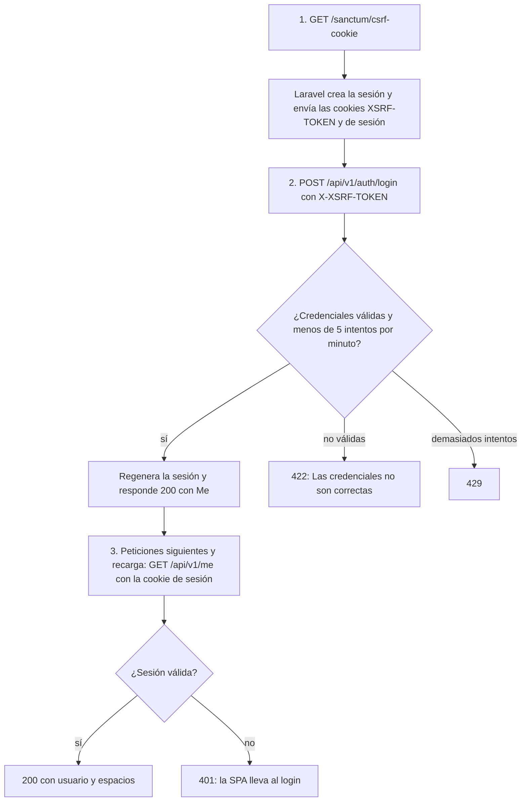

# 4. Arquitectura del sistema

*Versión 1 · 21/10/2026 · Autor: agente `documentador-tfg` · Estado: **diseño** (oleada 1). Las piezas marcadas «verificado» se han comprobado en el repositorio; el resto describe el diseño acordado en el contrato y los ADR.*

> **Decisiones de referencia.** [ADR‑0001](../arquitectura/ADR-0001-api-rest-y-spa.md) (API REST + SPA en monorepo), [ADR‑0002](../arquitectura/ADR-0002-espacios-de-trabajo.md) (espacios y roles), [ADR‑0003](../arquitectura/ADR-0003-gasto-vinculado.md) (gasto vinculado), [ADR‑0004](../arquitectura/ADR-0004-vehiculo-3d-procedural.md) (3D procedural).

## 4.1 Visión general

CarCare es una **aplicación de página única (SPA)** en React que consume una **API REST JSON** en Laravel. Ambas viven en un monorepo (`backend/`, `frontend/`) y se comunican solo a través del contrato versionado `/api/v1` ([contrato](../api/contrato-v1.md)). La base de datos es MySQL/MariaDB y los documentos se guardan en un disco privado del servidor.

```mermaid
flowchart LR
  subgraph NAV["Navegador"]
    direction TB
    UI["SPA React 19 + TypeScript<br/>React Router · páginas y componentes"]
    STATE["Estado de servidor<br/>TanStack Query · formularios RHF + Zod"]
    HTTP["Cliente HTTP<br/>fetch con cookie de sesión y X-XSRF-TOKEN"]
    THREE["Módulo 3D diferido<br/>chunk three: React Three Fiber + drei"]
    FALLBACK["Respaldo 2D<br/>silueta SVG + HTML accesible"]
    UI --> STATE --> HTTP
    UI -. "import diferido" .-> THREE
    UI --> FALLBACK
  end

  subgraph VITE["Vite dev server :5173 (solo desarrollo)"]
    PROXY["Proxy de /api y /sanctum"]
  end

  subgraph API["Laravel 12 · API /api/v1 :8000"]
    direction TB
    MW["Middleware<br/>sesión · CSRF · auth:sanctum · throttle · JSON"]
    ROUTES["Rutas routes/api.php<br/>+ route model binding"]
    FR["Form Request<br/>validación de entrada"]
    POL["Policy / Gate<br/>view · operate · manage · own"]
    CTRL["Controller<br/>orquesta la petición"]
    SVC["Service<br/>reglas de negocio y transacciones"]
    ORM["Eloquent Models<br/>relaciones, casts, enums"]
    RES["API Resource<br/>JSON del contrato"]
    MW --> ROUTES --> FR --> POL --> CTRL --> SVC --> ORM
    CTRL --> RES
  end

  DB[("MySQL / MariaDB<br/>BD carcare")]
  DISK[("Disco privado<br/>storage/app/private/documents")]

  HTTP -- "HTTP JSON, mismo origen" --> PROXY
  PROXY -- "reenvía a 127.0.0.1:8000" --> MW
  ORM --> DB
  SVC --> DISK
```

| Pieza | Estado a 21/10/2026 |
|-------|---------------------|
| Proxy de Vite para `/api` y `/sanctum`, chunks separados `three` y `charts` | ✔ Verificado en `frontend/vite.config.ts` |
| Dependencias de la SPA (React 19, React Router, TanStack Query, RHF + Zod, Recharts, Motion, Radix, R3F + drei, three) | ✔ Verificado en `frontend/package.json` |
| Interfaz pública del módulo 3D (`CarViewer`, `CarPreview`, `CarThumbnail`, `CarSilhouette`, `WorkshopScene`, `HeroScene`, `useWebGLAvailable`) | ✔ Verificado en `frontend/src/three/types.ts`; implementación aún **provisional (stubs)** |
| Laravel 12 + Sanctum 4 + Pest 3 | ✔ Verificado en `backend/composer.json` |
| Middleware `ForceJsonResponse`, enumerados PHP, modelos base, migraciones del dominio | ✔ Existen ficheros en `backend/app/` (en construcción por `backend-laravel`) |
| Rutas `/api/v1`, Form Requests, Policies, Services, Resources | ⏳ Pendiente (en construcción) |
| Despliegue en producción | ⏳ Sin decidir (oleada 4, agente `devops`) |

## 4.2 Capas y responsabilidades

### Cliente (SPA, `frontend/`)

| Capa | Responsabilidad | Tecnología |
|------|-----------------|------------|
| Presentación | Pantallas, componentes reutilizables, estados de carga/vacío/error, accesibilidad, responsive | React 19, Tailwind 4 con tokens propios, Radix UI, Motion, Recharts |
| Navegación | Rutas públicas y protegidas; cambio de espacio activo | React Router |
| Estado de servidor | Caché, reintentos, invalidación tras mutaciones; ninguna lógica de negocio duplicada | TanStack Query |
| Formularios | Validación en cliente con los mismos límites que el servidor; errores 422 mapeados a cada campo | React Hook Form + Zod |
| Contrato | Tipos de todas las respuestas y entradas | `frontend/src/api/types.ts` (fuente de verdad) |
| Formato | Números, importes y fechas en `es-ES` | `Intl` del navegador (el PHP del entorno no tiene `intl`) |
| 3D | Vehículo procedural, zonas, rayos X, taller, portada | three.js + React Three Fiber + drei, cargados de forma diferida |

### Servidor (API, `backend/`)

| Capa | Responsabilidad | Ejemplo |
|------|-----------------|---------|
| Middleware | Sesión, verificación CSRF, autenticación Sanctum, límite de peticiones, forzar respuestas JSON | `auth:sanctum`, `throttle`, `ForceJsonResponse` |
| Rutas | Mapear `/api/v1/...` a controladores; resolver modelos de la URL | `Route::apiResource`, *route model binding* |
| Form Request | Validar y normalizar la entrada (matrícula en mayúsculas, email en minúsculas, rangos, `confirm_mileage_drop`) | `StoreMaintenanceRequest` |
| Policy / Gate | Decidir si el usuario puede hacer la acción según su rol en el espacio del recurso | `WorkspacePolicy::operate`, `VehiclePolicy` |
| Controller | Orquestar: recibir la petición validada, llamar al servicio, devolver el Resource. Sin reglas de negocio | `MaintenanceController@store` |
| Service | Reglas de negocio y **transacciones**: km y retrocesos, gasto vinculado, recurrencia, numeración y elevadores, entrega de órdenes, cálculos de analítica | `MaintenanceService`, `MileageService`, `WorkOrderService` |
| Modelo (Eloquent) | Relaciones, *casts* (dinero, fechas, enumerados), *scopes* de espacio | `Vehicle`, `MaintenanceRecord` |
| API Resource | Serializar exactamente las formas del contrato (dinero como string, campos calculados) | `VehicleResource` |
| Persistencia | Integridad referencial, índices, unicidades | Migraciones MySQL/MariaDB |
| Almacenamiento | Ficheros privados con nombre UUID, servidos solo por un controlador autorizado | Disco `local` privado |

*Los nombres de clases de ejemplo son de diseño; se verificarán contra el código en la oleada 2 (ver [06‑diagrama-clases.md](06-diagrama-clases.md)).*

### Por qué esta división

- **Separación de responsabilidades** (ADR‑0001): la presentación no conoce la base de datos; las reglas de negocio están en un solo lugar (servicios) y no se repiten en controladores ni en el cliente.
- **Seguridad en el servidor**: la SPA puede ocultar un botón, pero la decisión real la toman las Policies (RNF-03).
- **Contrato explícito**: permitió construir backend y frontend en paralelo y hace que la API sea un entregable documentable.

### Orden de validación y autorización

En Laravel el *route model binding* resuelve el recurso de la URL antes de llegar al controlador, y el Form Request se ejecuta al resolver el método del controlador (su método `authorize()` corre **antes** que sus reglas `rules()`). La autorización puede hacerse en `FormRequest::authorize()`, en un middleware `can:` o en el controlador con `Gate::authorize()`.

**Consideración de seguridad.** Si un recurso ajeno se resolviera sin filtrar por espacio y la autorización ocurriera *después* de validar, una petición con datos no válidos a un recurso ajeno devolvería 422 en lugar de 404 y revelaría que existe. Para respetar RNF-02 el recurso debe resolverse **filtrado por los espacios del usuario** (o autorizarse antes de validar), de modo que el 404 preceda siempre al 422. *Pendiente de verificar en el código y en la auditoría de `seguridad`.*

## 4.3 Autenticación con Sanctum en modo SPA

Sanctum en modo SPA usa la **sesión de Laravel** (cookie HttpOnly) más un token CSRF legible por JavaScript (`XSRF-TOKEN`) que el cliente devuelve en la cabecera `X-XSRF-TOKEN`. No hay tokens en `localStorage`, lo que reduce el impacto de un posible XSS. Para que funcione, el navegador y la API deben compartir origen o dominio:

- **Desarrollo** (✔ verificado en `vite.config.ts`): el navegador solo habla con Vite en `localhost:5173`, que reenvía `/api` y `/sanctum` a `127.0.0.1:8000`. Al ser el mismo origen no hace falta CORS.
- **Producción**: ⏳ pendiente. La opción coherente con este diseño es servir la SPA compilada y la API bajo el mismo dominio (o subdominios con `SANCTUM_STATEFUL_DOMAINS` y `SESSION_DOMAIN` configurados).

El diagrama de secuencia detallado está en [05‑diagramas-secuencia.md](05-diagramas-secuencia.md#51-inicio-de-sesión-con-sanctum-spa). Requisitos: RF-03…RF-06, RNF-01.

## 4.4 Modelo de acceso: espacios y roles

Toda petición autenticada se resuelve en tres pasos:

1. **Localizar el espacio** del recurso: directamente (`/workspaces/{ws}/...`) o a través del vehículo (`/vehicles/{v}`, `/maintenance/{r}` → vehículo → espacio).
2. **Comprobar la pertenencia**: si el usuario no es miembro de ese espacio ⇒ **404**.
3. **Comprobar la capacidad** según su rol (`view` ⊂ `operate` ⊂ `manage` ⊂ `own`): si no la tiene ⇒ **403**.

Las Policies de cada recurso delegan en la del espacio (`WorkspacePolicy`), de modo que la tabla de permisos vive en un único sitio. Detalle de permisos: [01‑requisitos.md §1.1](01-requisitos.md#11-alcance-y-convenciones).

## 4.5 Transacciones y reglas de negocio

| Operación | Qué se agrupa en una transacción | Requisitos |
|-----------|----------------------------------|------------|
| Crear/editar intervención | Intervención + líneas + gasto vinculado (personal) + lectura de km + actividad | RF-27…RF-29 |
| Archivar/restaurar intervención | Cambio de `archived_at` + eliminar/recrear gasto vinculado | RF-32 |
| Registrar km | Lectura + recálculo de `current_mileage` | RF-23, RF-26 |
| Completar recordatorio | Lectura (si hay km) + `done` + siguiente recordatorio + actividad | RF-43 |
| Crear orden | Número correlativo con bloqueo + comprobación de elevador + orden + líneas + lectura | RF-62, RF-66 |
| Entregar orden | Estado final + liberar elevador + intervención con líneas copiadas + enlace + actividad | RF-65 |

Diagramas de secuencia de las más importantes en [05‑diagramas-secuencia.md](05-diagramas-secuencia.md).

## 4.6 Gestión de documentos

1. Subida `multipart/form-data` a `POST /vehicles/{v}/documents`.
2. Validación: tamaño ≤ 10 MB y **tipo MIME real** (no la extensión) entre PDF, JPEG, PNG y WebP.
3. Se guarda en `storage/app/private/documents/{workspace}/{uuid}.{ext}`: fuera de `public/`, con nombre interno no predecible. El nombre original se sanea y se guarda solo como metadato.
4. Descarga por `GET /documents/{d}/download`: el controlador comprueba la Policy y emite el fichero con `Content-Disposition` y `X-Content-Type-Options: nosniff`.

La migración `documents` (✔ verificada) incluye las columnas `disk` y `path`, lo que permite cambiar a un almacenamiento compatible con S3 sin alterar el modelo. Requisitos: RF-53…RF-56, RNF-05.

## 4.7 Estrategia 3D

### Generación procedural
El vehículo **no es un modelo descargado**: se genera por código ([ADR‑0004](../arquitectura/ADR-0004-vehiculo-3d-procedural.md)). Para cada uno de los 9 tipos de carrocería se define un perfil lateral que se extruye con bisel; se añaden ruedas, lunas, faros y pilotos y se tiñe con el `color_hex` del vehículo. No hay logotipos ni formas de modelos reales (RNF-17). La iluminación usa `Lightformer` de drei, sin descargar mapas HDRI externos.

### Componentes y su uso

| Componente | Dónde | Comportamiento |
|------------|-------|----------------|
| `CarViewer` (`showcase`) | Dashboard, cabecera de la ficha | Coche protagonista con autorrotación lenta, sin zonas |
| `CarViewer` (`inspect`) | Ficha → zonas | Órbita + puntos de zona seleccionables alimentados por `GET /vehicles/{v}/zones`; opción `xray` |
| `CarPreview` | Formulario de vehículo | Cambia carrocería y color en vivo, sin controles |
| `CarThumbnail` | Listados | **Imagen estática** (render cacheado o silueta): nunca un WebGL por tarjeta |
| `CarSilhouette` | Respaldo universal | SVG 2D sin WebGL |
| `WorkshopScene` | Dashboard del taller | Nave con elevadores numerados y coches de órdenes abiertas; zona de espera |
| `HeroScene` | Portada pública | Escena coreografiada con el desplazamiento |

La SPA solo importa desde `@/three` y solo usa las props de `frontend/src/three/types.ts` (✔ verificado). Así el módulo 3D se puede sustituir o desactivar sin tocar las pantallas.

### Degradación y accesibilidad
- `useWebGLAvailable()` decide entre 3D y **silueta SVG**.
- Con `prefers-reduced-motion` se desactivan autorrotación y transiciones de cámara.
- El lienzo tiene nombre accesible (`ariaLabel`) y **toda su información existe también en HTML** (lista de zonas con estado en texto, lista de elevadores), navegable con teclado.
- El estado de las zonas nunca se comunica solo por color y siempre lleva la etiqueta «según tus intervalos, no medido».

### Rendimiento

| Medida | Efecto | Estado |
|--------|--------|--------|
| three.js y `@react-three/*` en un chunk propio (`manualChunks`) cargado con `import()` diferido | La aplicación arranca sin descargar el motor 3D | Chunk configurado ✔; carga diferida ⏳ pendiente de la implementación real |
| Un único `<Canvas>` por pantalla | Un solo contexto WebGL; evita el límite de contextos del navegador | ⏳ Diseño |
| `frameloop="demand"` cuando la escena está quieta | No consume GPU sin interacción | ⏳ Diseño |
| *Device pixel ratio* limitado | Coste de dibujo acotado en pantallas de alta densidad | ⏳ Diseño (valor a fijar por `experto-3d`) |
| Miniaturas estáticas en listados | Listados de 20+ vehículos sin 20 contextos WebGL | ⏳ Diseño |
| Geometría procedural y sin assets externos | Sin descargas de modelos ni texturas pesadas | ⏳ Diseño |

Los objetivos cuantitativos (FPS, tamaño del chunk, tiempo hasta interacción) **no se han fijado todavía**; se acordarán con `experto-3d` y se medirán en la oleada 3 ([07‑plan-de-pruebas.md](07-plan-de-pruebas.md)).

## 4.8 Entornos

| Entorno | Componentes | Estado |
|---------|-------------|--------|
| Desarrollo | XAMPP (PHP 8.2.12, MariaDB 10.4) · `php artisan serve` en :8000 · `npm run dev` en :5173 con proxy | ✔ Descrito en `CLAUDE.md` |
| Pruebas automatizadas | Pest sobre SQLite en memoria · Vitest con jsdom · Playwright con backend y frontend arrancados | ✔ Configurado en `package.json` / `composer.json`; resultados pendientes |
| Producción | — | ⏳ Pendiente (oleada 4). ⚠️ *Puede depender de Ilerna* si se exige una demo desplegada. |
