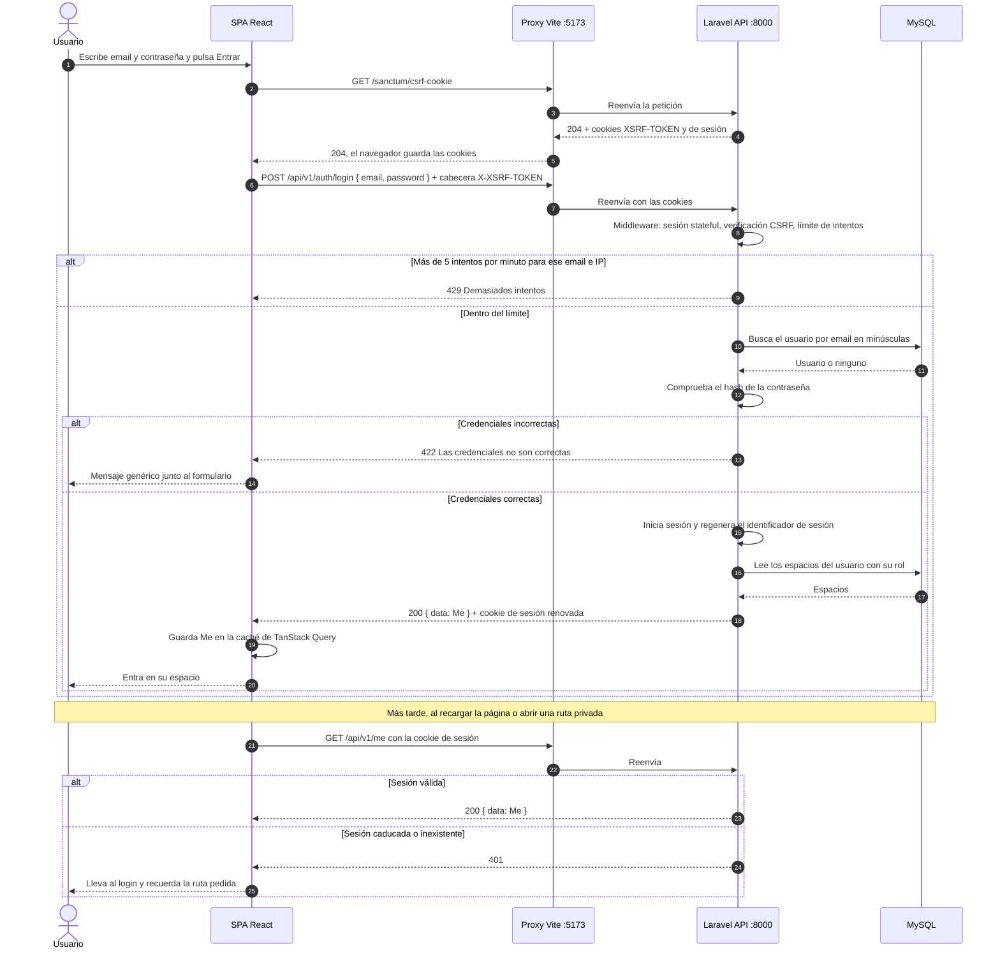
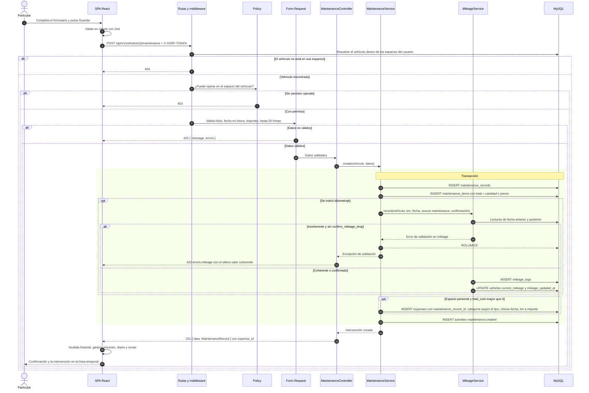
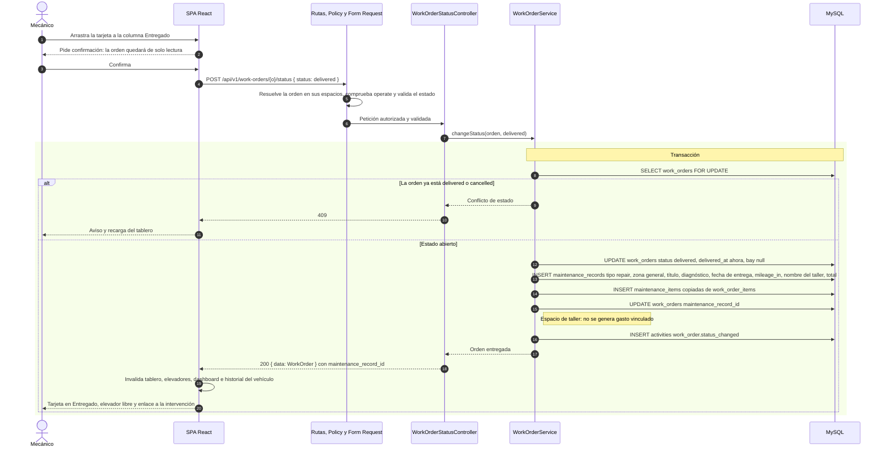
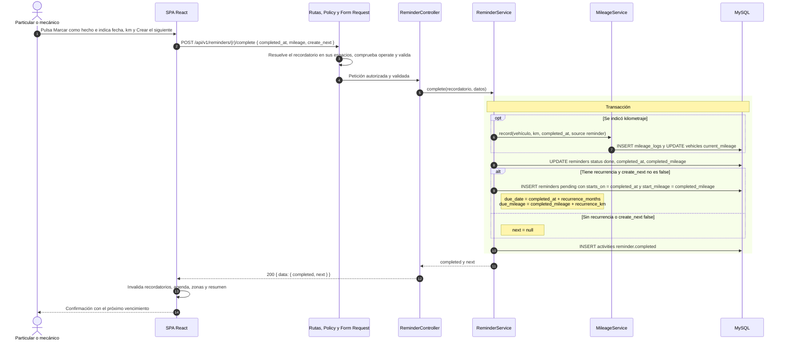
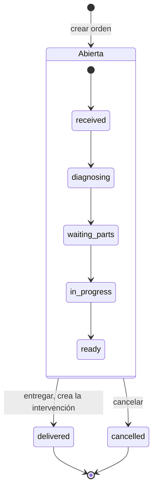

# 5. Diagramas de secuencia

*Versión 1 · 21/10/2026 · Autor: agente `documentador-tfg` · Estado: **diseño, pendiente de verificar contra el código**. Los diagramas siguen el contrato v1 ([§3.1, §3.4, §3.5, §3.7, §3.11](../api/contrato-v1.md)) y la arquitectura de capas de [04‑arquitectura.md](04-arquitectura.md). Los nombres de controladores y servicios son de diseño: a 21/10/2026 el backend todavía no tiene controladores ni servicios (sí migraciones, enumerados y modelos base).*

**Convenciones.** Flecha continua = petición o llamada; discontinua = respuesta. Las peticiones de la SPA pasan por el proxy de Vite en desarrollo; para no recargar los diagramas, solo se dibuja en el primero. Las cajas sombreadas son **transacciones de base de datos**: o se confirma todo o no se guarda nada.

## 5.1 Inicio de sesión con Sanctum SPA

Requisitos: RF-04, RF-06, RNF-01. Caso de uso relacionado: iniciar sesión.

**Por qué así.** La cookie de sesión es HttpOnly (JavaScript no puede leerla) y el token CSRF impide que otra web envíe peticiones en nombre del usuario. Regenerar la sesión al iniciarla evita la fijación de sesión. El mensaje genérico no revela si el email existe.

## 5.2 Crear una intervención con coste (gasto vinculado)

Requisitos: RF-27, RF-28, RF-29, RF-26 · Caso de uso CU-02 · [ADR‑0003](../arquitectura/ADR-0003-gasto-vinculado.md).

**Puntos clave.**
- La comprobación de pertenencia (404) y de rol (403) se hace **antes** de validar el cuerpo, para no revelar la existencia de recursos ajenos (ver [04 §4.2](04-arquitectura.md#orden-de-validación-y-autorización)).
- Intervención, líneas, lectura de km, gasto vinculado y actividad se confirman **juntos**: no puede quedar un gasto sin intervención ni una intervención con coste sin su gasto.
- Si el km es incoherente, la SPA pide confirmación y repite la petición con `confirm_mileage_drop: true` (CU-03).

## 5.3 Entregar una orden de trabajo

Requisitos: RF-64, RF-65 · Caso de uso CU-07.

**Puntos clave.**
- El bloqueo `FOR UPDATE` impide que dos usuarios entreguen o modifiquen la misma orden a la vez.
- El enlace orden → intervención se guarda en `work_orders.maintenance_record_id` (✔ verificado en la migración `2026_10_21_000003_create_work_orders_tables.php`); el `work_order_id` que expone la intervención en el JSON se obtiene por la relación inversa.
- **Pendiente de aclarar:** si la intervención creada debe generar una segunda lectura de km con el mismo valor que la de entrada (ver [01 §1.4](01-requisitos.md#14-huecos-y-preguntas-abiertas-detectadas-al-especificar)).

## 5.4 Completar un recordatorio recurrente

Requisitos: RF-43, RF-42, RF-26 · Caso de uso CU-04.

**Puntos clave y huecos.**
- El estado (`overdue`, `soon`, `ok`, `unknown`) y el progreso del nuevo recordatorio no se guardan: se calculan al consultarlo.
- **Hueco del contrato:** `CompleteReminderInput` no admite `confirm_mileage_drop`, de modo que no está definido cómo confirmar un km incoherente en este flujo.
- **Hueco del contrato:** con recurrencia solo por km y sin km de completado, el siguiente recordatorio no tendría vencimiento.

## 5.5 Diagrama de estados complementario: orden de trabajo

El ciclo de vida de una orden (contrato §3.11) explica por qué la entrega es la única transición con efectos en otra entidad. Requisitos: RF-62, RF-64, RF-65, RF-66.

- Entre los cinco estados abiertos el movimiento es **libre** en ambos sentidos (tablero kanban); el diagrama muestra el recorrido habitual.
- Pasar a `ready` fija `completed_at`. Pasar a `ready`, `delivered` o `cancelled` libera el elevador salvo que se indique otro.
- `delivered` y `cancelled` son **finales**: cualquier cambio posterior responde 409 y la orden queda de solo lectura.
