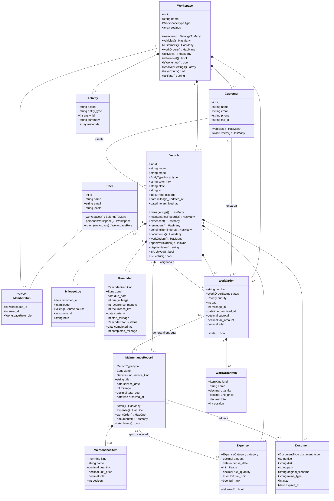
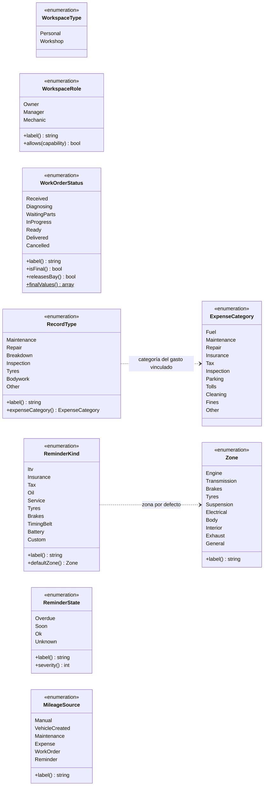
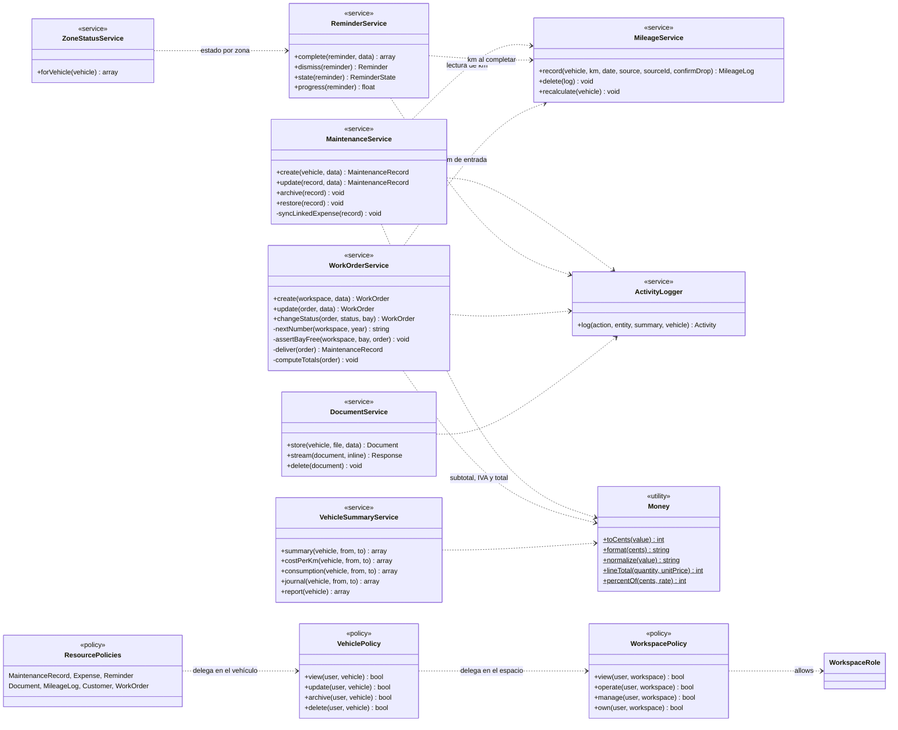

# 6. Diagrama de clases

*Versión 1 · 21/10/2026 · Autor: agente `documentador-tfg` · Estado: **mixto**. El modelo de dominio y los enumerados se han contrastado con el código que el backend estaba escribiendo durante esta oleada; los servicios y las policies son **diseño, pendiente de verificar contra el código**. La tabla de §6.4 indica el estado de cada clase.*

> **Fuentes.** `backend/app/Models/`, `backend/app/Enums/`, `backend/app/Support/` (consultados el 21/10/2026, en construcción), contrato v1 y [03‑modelo-de-datos.md](03-modelo-de-datos.md). Notación UML: `*--` composición (el hijo se borra con el padre), `--` asociación, `..>` dependencia; `$` marca un método estático.

## 6.1 Modelo de dominio (Eloquent)

Solo se muestran los atributos y métodos más significativos de cada clase; los tipos de dinero se representan como `decimal`, aunque en PHP se manejan como cadenas o céntimos enteros (clase `Money`, §6.3).

**Notas de diseño.**
- `Membership` representa la tabla pivote `workspace_user`; en Eloquent no es un modelo propio sino `belongsToMany(...)->withPivot('role')` en `User` y `Workspace` (✔ verificado).
- `User::roleIn()` devuelve `null` si el usuario no pertenece al espacio, y las policies traducen ese caso en **404** (✔ verificado en el comentario del método).
- Atributos calculados que no se guardan: `Vehicle::displayName()`, `Expense::isLinked()`, `WorkOrder::isLate()`, y el estado y progreso de `Reminder`.

## 6.2 Enumerados principales

Los enumerados son *backed enums* de PHP 8.1+ guardados como `string` en la base de datos (las migraciones usan columnas `VARCHAR`, no `ENUM` de MySQL: añadir un valor no exige migración). Todos comparten el *trait* `EnumHelpers::values()`.

Otros enumerados con la misma forma (sin métodos relevantes para el diseño): `FuelType`, `Transmission`, `BodyType`, `ServiceKind`, `ItemKind`, `FuelUnit`, `ReminderStatus`, `DocumentType`, `Priority`. Valores en [03 §3.3](03-modelo-de-datos.md#33-enumerados).

**Por qué la lógica vive en los enumerados.** Reglas pequeñas y estables del contrato quedan junto al valor al que se refieren y se pueden probar de forma unitaria: qué categoría de gasto corresponde a cada tipo de intervención (`RecordType::expenseCategory`), la zona por defecto de un recordatorio (`ReminderKind::defaultZone`), qué estados son finales o liberan el elevador (`WorkOrderStatus`), la gravedad para ordenar zonas (`ReminderState::severity`) y la tabla de permisos (`WorkspaceRole::allows`).

## 6.3 Servicios, policies y utilidades

> **Diseño, pendiente de verificar contra el código.** A 21/10/2026 no existen todavía `app/Services` ni `app/Policies`. Los nombres y firmas siguen la arquitectura de [04‑arquitectura.md](04-arquitectura.md) y las transacciones de [05‑diagramas-secuencia.md](05-diagramas-secuencia.md). Las utilidades `Money`, `Dates`, `Km` y el *cast* `DateOnly` sí existen (✔).

**Responsabilidades.**

| Clase | Responsabilidad | Requisitos |
|-------|-----------------|------------|
| `MileageService` | Único punto que escribe lecturas y la caché `current_mileage`; control de retrocesos | RF-23…RF-26 |
| `MaintenanceService` | Intervención + líneas + gasto vinculado en transacción; archivado y restauración | RF-27…RF-32 |
| `ReminderService` | Estado, progreso, completar con recurrencia, descartar | RF-41…RF-45 |
| `ZoneStatusService` | Las 10 zonas con su estado y base | RF-46 |
| `VehicleSummaryService` | Totales, coste por km, consumo, «desde el último», diario e informe | RF-36…RF-39, RF-58, RF-59 |
| `WorkOrderService` | Numeración sin huecos, elevadores, totales, cambios de estado y entrega | RF-62…RF-68 |
| `DocumentService` | Almacenamiento privado y descarga | RF-53…RF-56 |
| `ActivityLogger` | Registro de actividad sin datos sensibles | RF-60 |
| `WorkspacePolicy` y policies de recurso | Pertenencia (404) y capacidad por rol (403) | RF-16, RNF-02, RNF-03 |
| `Money` (✔) | Aritmética de dinero en céntimos enteros, redondeo *half‑up*, formato de 2 decimales | RNF-06 |

## 6.4 Estado de verificación

**Revisión del 21/10/2026** (`backend/app/`, en construcción por `backend-laravel`).

| Clase | Estado | Fichero |
|-------|--------|---------|
| `User`, `Workspace`, `Vehicle`, `Customer`, `MileageLog`, `MaintenanceRecord`, `MaintenanceItem`, `WorkOrderItem` | ✔ Existen (atributos y relaciones del diagrama contrastados) | `app/Models/*.php` |
| `Expense`, `Reminder`, `Document`, `WorkOrder`, `Activity` | ⏳ Referenciadas por otros modelos; fichero aún no creado en la revisión | — |
| Los 18 enumerados (+ *trait* `EnumHelpers`) | ✔ Existen | `app/Enums/*.php` |
| `Money`, `Dates`, `Km`, `DateOnly` | ✔ Existen | `app/Support/*.php`, `app/Casts/DateOnly.php` |
| Servicios y policies | ⏳ **Diseño, pendiente de verificar contra el código** | — |

> En la oleada 2 se regenerará este diagrama a partir del código final.
