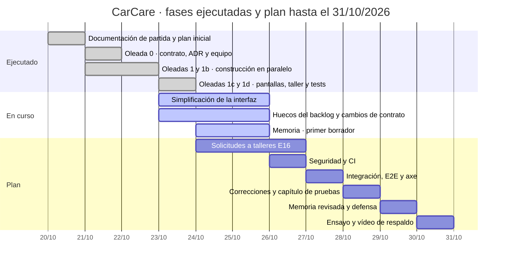

# 3. Planificación y metodología

## 3.1 Enfoque general

El proyecto combina tres prácticas, cada una con un motivo concreto:

*Tabla 3.1. Prácticas del enfoque de trabajo.*

| Práctica | En qué consiste | Por qué |
|----------|-----------------|---------|
| **Desarrollo guiado por contrato** (*contract-first*) | Antes de programar se escribió el contrato de la API ([`docs/api/contrato-v1.md`](../../api/contrato-v1.md)) y los tipos TypeScript de todas las respuestas ([`frontend/src/api/types.ts`](../../../frontend/src/api/types.ts)). Backend y frontend se construyen contra él; cualquier cambio se propone, se aprueba y se anota en su historial | Permite construir servidor y cliente en paralelo y convierte la API en un entregable verificable: una prueba compara cada respuesta real con su tipo |
| **Iteraciones por oleadas** | Cada oleada tiene un objetivo, unos responsables por área y un cierre con informe y evidencias | Sin fecha oficial de entrega (D6), no se podían fijar *sprints* de duración fija. Las oleadas se cierran por objetivo, no por calendario |
| **Backlog priorizado con MoSCoW** (Clegg y Barker, 1994) | Épicas E0‑E15 con historias *Must*, *Should* y *Could*, criterios "Dado / cuando / entonces" y un núcleo defendible por si hay que recortar | Ordena qué se construye primero y deja por escrito qué se sacrifica si falta tiempo (D9) |

Las decisiones con impacto en arquitectura o datos se registran como ADR en `docs/arquitectura/`, y las de producto en `CarCare/03_decisiones/registro-decisiones.md`. Las que solo puede tomar el autor (gustos, alcance, prioridades, TFG) se le preguntan explícitamente.

## 3.2 Uso de un asistente de programación con inteligencia artificial

El desarrollo se ha apoyado en **Claude Code**, un asistente de programación con IA de Anthropic que trabaja sobre el repositorio local: lee y escribe archivos y ejecuta comandos (tests, *build*, servidores) en el equipo del autor. Se expone aquí de forma factual porque condiciona cómo se ha construido el sistema y cómo debe leerse esta memoria.

> ⚠️ **Depende de Ilerna.** Cómo presentar y valorar el uso de IA en el TFG lo decidirá el autor cuando conozca la normativa del módulo de Proyecto. Este apartado describe lo ocurrido, sin valorarlo.

### Organización en agentes

El asistente se organizó como un equipo de **diez agentes especializados**, definidos en `.claude/agents/*.md` el 21/10/2026. Cada uno tiene un rol, una zona del repositorio de la que es responsable y normas de calidad:

*Tabla 3.2. Agentes del equipo, su rol y su zona.*

| Agente | Rol | Zona |
|--------|-----|------|
| `arquitecto` | Diseño técnico, contrato de la API y ADR | `docs/api/`, `docs/arquitectura/`, `frontend/src/api/types.ts` |
| `producto` | Backlog, decisiones, competencia y pruebas con usuarios | `CarCare/` |
| `backend-laravel` | API, base de datos, reglas de negocio y tests | `backend/` |
| `frontend-react` | Pantallas, formularios, navegación y accesibilidad | `frontend/` salvo el 3D |
| `experto-3d` | Escenas y modelos 3D | `frontend/src/three/` |
| `disenador-ux` | Revisión visual, usabilidad y accesibilidad | Revisión |
| `qa-tester` | Pruebas extremo a extremo y auditorías de calidad | `frontend/e2e/`, revisión de tests |
| `seguridad` | Auditoría de seguridad y privacidad | Revisión |
| `devops` | Scripts de arranque, integración continua y despliegue | `scripts/`, `.github/` |
| `documentador-tfg` | Memoria, diagramas y manuales | `docs/tfg/` |

### Papel del autor

El autor actúa como **director del proyecto**: fija el alcance y las prioridades, toma las decisiones de producto y de diseño, encarga el trabajo a través de una sesión principal que coordina a los agentes y revisa sus entregas ([`docs/equipo/GUIA-LIDERAZGO.md`](../../equipo/GUIA-LIDERAZGO.md)). Decisiones tomadas expresamente por el autor y registradas con su fecha:

*Tabla 3.3. Decisiones tomadas por el autor.*

| Decisión | Contenido | Fecha |
|----------|-----------|-------|
| D7 | Particular y taller en el mismo producto | 21/10/2026 |
| D8 | Interfaz 3D interactiva, sin datos inventados | 21/10/2026 |
| D16 | Sin modelos 3D ni logotipos de marcas: réplica procedural por carrocería | 23/10/2026 |
| D12 | El taller calcula importes pero no emite facturas; la pantalla se llama "Analítica" | 24/10/2026 |
| D17 | Recuperar la contraseña con el correo escrito solo en el registro local | 24/10/2026 |
| D6 (parcial) | Sin fecha oficial; objetivo de memoria y defensa antes del 31/10/2026 | 24/10/2026 |
| — | Simplificar la interfaz ("la veo sobrecargada") y dar un aspecto más natural | 23/10/2026 |
| — | Nueva función de solicitudes de reparación de un particular a un taller (E16) | 24/10/2026 |

D2, D3 y D4 (forma de la aplicación, gasto vinculado e imagen del vehículo) se aplicaron el 21/10/2026 como recomendación al arrancar la construcción y figuran como "aceptadas provisionalmente": el autor puede revertirlas.

### Protocolo de trabajo y control

Cada encargo a un agente termina con un **informe** en `docs/equipo/informes/` que incluye objetivo, cambios, archivos tocados, evidencias (comandos ejecutados y su resultado), limitaciones y siguiente paso. El estado de cada agente se lleva en [`docs/equipo/TABLERO.md`](../../equipo/TABLERO.md). Las reglas comunes están en `CLAUDE.md`; entre ellas:

- ninguna cifra ni función sin fuente real;
- autorización siempre en el servidor;
- no declarar nada terminado sin probarlo;
- ningún agente edita fuera de su zona sin decirlo.

Además, un **piloto automático** (`scripts/autopiloto/`) lanza cada hora una sesión no interactiva que toma la primera tarea pendiente de la cola ([`docs/equipo/AUTOPILOTO.md`](../../equipo/AUTOPILOTO.md)) y deja una nota en `CarCare/05_sesiones/`.

### Riesgo asociado y mitigación

El riesgo R7 del registro de riesgos es "código que no sepa defender ante el tribunal", más probable con varios agentes generando mucho código en paralelo. Las mitigaciones previstas son:

- commits por área;
- informes con evidencias;
- un ADR por cada decisión;
- que el autor lea los informes y pida explicación de cada módulo antes de la defensa.

[PENDIENTE: tarea 31 — preparación de la defensa, con las 20 preguntas más probables del tribunal y su respuesta.]

## 3.3 Cronología real

Las fechas salen del historial de Git, de las notas de sesión (`CarCare/05_sesiones/`), de los informes de los agentes y del tablero. El repositorio recibió sus primeros commits el **23/10/2026 a las 08:53**, agrupando por área el trabajo de los días anteriores. Por eso, antes de esa hora, la cronología se apoya en las fechas de los documentos y del tablero, no en commits.

*Tabla 3.4. Cronología real del proyecto.*

| Fecha | Hito | Evidencia |
|-------|------|-----------|
| 20/10/2026 | Documentación de producto de partida y plan inicial v1 ("No se ha creado repositorio ni código"); decisiones D1‑D6 planteadas | `Car_Care_Documentacion/`, `CarCare/01_plan/plan-inicial-v1.md` |
| 21/10/2026 | Alcance ampliado a particular + taller + 3D (D7, D8). **Oleada 0**: andamiaje de Laravel 12 y React + Vite, contrato de la API v1, ADR‑0001…0004 y definición del equipo de agentes | `docs/arquitectura/`, `docs/api/contrato-v1.md` (historial: versión inicial del 21/10), `.claude/agents/` |
| 21/10/2026 | Backlog reescrito (103 historias), análisis de la competencia y guion de pruebas con usuarios. Primera versión de requisitos, casos de uso y diagramas | [Informe de producto del 21/10](../../equipo/informes/2026-10-21-producto-backlog-y-decisiones.md); `docs/tfg/01…08` |
| 21/10/2026 | **Oleada 1** (construcción en paralelo): se interrumpe por el límite de uso del asistente; solo termina producto | Tablero, tabla de oleadas |
| 22/10/2026 | **Oleada 1b**. La sesión principal verifica que el inicio de sesión, el garaje, la ficha con 3D y zonas, el diario y los gastos funcionan con datos reales | Tablero, oleada 1b |
| 23/10/2026, 01:40 | **Oleada 1c** interrumpida por el límite de uso | Tablero, oleada 1c |
| 23/10/2026, 08:53 | Primeros 7 commits en `develop`: documentación, planificación, equipo, API, 3D, SPA y scripts | `git log` (`6090ee2`…`7870329`) |
| 23/10/2026, 08:54‑09:00 | Primeras ejecuciones del piloto automático; se detecta y corrige un fallo que lo relanzaba sin esperar | `CarCare/05_sesiones/2026-10-23-autopiloto-0856.md`, commit `a8a0388` |
| 23/10/2026, 22:51 | **Oleada 1d** confirmada: batería de la API con 462 pruebas en verde, portada 3D, modo taller completo, API con OPcache | Commits `57249fb`, `1921a16`, `779dc5c`, `971da7e`; [informe del backend](../../equipo/informes/2026-10-23-backend-laravel-api-v1.md) |
| 23/10/2026, 22:50‑23:40 | El autor pide simplificar la interfaz. Auditoría de UX, mapa de huecos del backlog (71 de 90 historias *Must* y *Should* construidas) y reparto de las tareas 16‑29 | Informes de `disenador-ux` y `producto` del 23/10 |
| 24/10/2026, 00:00 | Nuevo corte por el límite de uso | Tablero, fila de la sesión interactiva |
| 24/10/2026 | Decisiones D12, D17 y objetivo del 31/10. ADR‑0005 (RGPD del cliente del taller) y ADR‑0006 (recuperar la contraseña) aceptados; tres cambios aditivos en el contrato. Empieza esta memoria. El autor pide la función de solicitudes de reparación (E16) | `registro-decisiones.md`; historial del contrato; tarea 32 de la cola |
| 24/10/2026, 14:10 | Repositorio publicado en GitHub como privado, con `main` como rama por defecto y `develop` con todos los commits | Tarea 0 de `AUTOPILOTO.md` |
| 25/10/2026 | Cierre del contrato y de los datos de demostración (commit `92ad333`) y validación de la carga ligera y del *build* del frontend (`d8a31bb`); 462 pruebas en verde | [Informe de cierre](../../equipo/informes/2026-10-25-sesion-principal-cierre.md) |
| 26/10/2026 | Backend de las tareas 27, 28 y 29 (commit `f1265b6`): 511 pruebas en verde. ADR‑0007 (E16) aceptado por el arquitecto. Primer borrador completo de la memoria, con los quince capítulos | Commit `f1265b6`; ADR‑0007; informe de la memoria |

Los cortes por el límite de uso del asistente han sido el principal factor de retraso. La mitigación adoptada es que cada agente escriba su informe **mientras trabaja**, de modo que la siguiente sesión pueda retomar desde el disco sin rehacer nada (regla 7 del piloto automático).

### Diagrama temporal

*Figura 3.1. Cronología real del proyecto en un diagrama de Gantt.*

## 3.4 Plan hasta la entrega

No hay fecha oficial de entrega ni de defensa (D6). El autor fijó el objetivo de tener la memoria y una defensa preparada antes del 31/10/2026, con este orden de prioridad cuando el tiempo no alcance: **memoria > aplicación completa y simple > calidad (E2E, seguridad, accesibilidad) > defensa > lo demás** ([`AUTOPILOTO.md`](../../equipo/AUTOPILOTO.md), "Plan hasta el 31/10/2026").

*Tabla 3.5. Plan hasta el 31/10/2026.*

| Día | Objetivo |
|-----|----------|
| Sáb 24/10 | Analítica, datos demo, cambios de contrato, "Mis órdenes", memoria (capítulos 1‑7) |
| Dom 25/10 | Simplificación de las pantallas, recuperar la contraseña, memoria (diseño e implementación) |
| Lun 26/10 | Solicitudes a talleres (E16), resumen imprimible de la orden, RGPD, auditoría de seguridad e integración continua |
| Mar 27/10 | Integración completa con las 4 cuentas demo, E2E y axe |
| Mié 28/10 | Correcciones, capítulo de pruebas con resultados reales, manuales y anexos |
| Jue 29/10 | Memoria revisada y exportada; diapositivas, guion de la demo y preguntas |
| Vie 30/10 | Ensayo de la defensa, vídeo de respaldo y margen |

[PENDIENTE: tarea 10 — al cerrar la memoria, comparar este plan con lo realmente hecho y explicar las desviaciones.]

> ⚠️ **Depende de Ilerna.** Si la guía exige un registro de horas dedicadas, hay que reconstruirlo: no se ha llevado un registro de tiempo. No se incluye ninguna estimación de horas para no inventarla.

## 3.5 Gestión de riesgos

El registro completo está en [`CarCare/01_plan/riesgos.md`](../../../CarCare/01_plan/riesgos.md). Los que más han condicionado el proyecto:

*Tabla 3.6. Riesgos principales y mitigación aplicada.*

| ID | Riesgo | Mitigación aplicada |
|----|--------|---------------------|
| R1 | No tener la normativa de Ilerna | Estructura provisional de la memoria y marcas "⚠️ Depende de Ilerna" |
| R5 / R15 | Fuga de datos entre espacios o permisos mal aplicados | Policies en cada ruta y una prueba de aislamiento por endpoint desde el principio |
| R7 | Código que el autor no sepa defender | Informes con evidencias, ADR, commits por área, explicación de cada módulo antes de la defensa |
| R12 | Alcance ampliado frente a un calendario sin fijar | Núcleo defendible marcado en el backlog y plan de recorte D9 |
| R13 | Rendimiento del 3D en equipos modestos | Carga diferida, un lienzo por pantalla, miniaturas estáticas, alternativa 2D; tarea 20 de medición |
| R18 | Presentar los totales de la orden como factura | D12: no se emiten facturas y se rotula "no es una factura" |
| R20 | Que el 3D no aporte valor real | Medirlo en las pruebas con usuarios; la simplificación de la interfaz ya lo limita a la ficha del vehículo y al taller |

## 3.6 Control de versiones

El repositorio es un **monorepo Git** con dos ramas permanentes ([`CONTRIBUTING.md`](../../../CONTRIBUTING.md)):

- `develop`, para el trabajo diario: cada sesión termina con commits aquí;
- `main`, la versión estable: solo cambia por *pull request* al cerrar un hito (`v0.1` primera versión mostrable, `v0.2` calidad, `v0.3` documentación, `v1.0` entrega) y con el visto bueno del autor.

Los mensajes siguen *Conventional Commits* en español, con un commit por área tocada (`feat(backend): …`, `test(backend): …`, `docs(equipo): …`). Desde el 24/10/2026 el repositorio está publicado en GitHub como repositorio **privado** (`albertomanana/carcare`, decisión D5, tarea 0 de la cola). A 26/10/2026, `develop` tiene 36 commits y `main` solo el commit inicial con el README y las normas de contribución, porque todavía no se ha cerrado ningún hito (capítulo 9, §9.2). Los `.env`, `vendor/`, `node_modules/` y los archivos subidos por los usuarios están excluidos del control de versiones.
