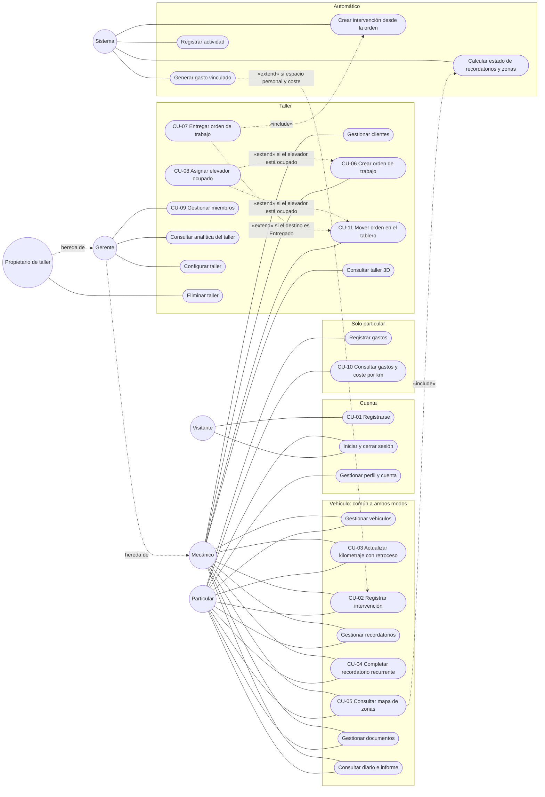

# 5. Casos de uso

## 5.1 Actores

| Actor | Tipo | Descripción | Rol técnico |
|-------|------|-------------|-------------|
| **Visitante** | Primario | Persona sin sesión: ve la portada, se registra o inicia sesión | — |
| **Particular** | Primario | Propietario que lleva el seguimiento de sus vehículos en su espacio personal | `owner` de un espacio `personal` |
| **Mecánico** | Primario | Miembro de un taller que opera el día a día: vehículos, órdenes, elevadores, historial, recordatorios y documentos. No ve importes ni gastos | `mechanic` |
| **Gerente** | Primario | Hace todo lo del mecánico y además gestiona miembros, ajustes, gastos, analítica, archivado y borrados | `manager` |
| **Propietario de taller** | Primario | Hace todo lo del gerente y además puede eliminar el taller y nombrar o retirar propietarios | `owner` de un espacio `workshop` |
| **Sistema** | Secundario | Efectos automáticos del servidor: gasto vinculado, lecturas de km derivadas, estados calculados, intervención al entregar una orden, registro de actividad | — |

**Generalización.** En un taller las capacidades son acumulativas, de modo que el gerente hereda los casos de uso del mecánico y el propietario los del gerente. Una misma persona puede ser particular en su espacio y mecánico en un taller con la misma cuenta (ADR‑0002).

## 5.2 Diagrama de casos de uso

Mermaid no tiene un tipo específico de diagrama de casos de uso, así que se representa con un diagrama de flujo: los actores son círculos y los casos de uso, cápsulas. La línea discontinua "hereda de" es la generalización entre actores; «include» y «extend» siguen la semántica UML.

*Por legibilidad no se dibuja la asociación de "Iniciar y cerrar sesión" y "Gestionar perfil y cuenta" con los actores del taller (todos los usuarios registrados la tienen), ni la inclusión de "Registrar actividad" en cada caso de uso de escritura.*

## 5.3 Catálogo

| Caso de uso | Actores | Requisitos |
|-------------|---------|------------|
| CU-01 Registrarse | Visitante | RF-03, RF-11 |
| Iniciar y cerrar sesión | Todos | RF-04, RF-05, RF-06 |
| Gestionar perfil y cuenta | Usuarios registrados | RF-07, RF-08, RF-09, RF-10 |
| Gestionar vehículos | Particular, Mecánico (archivar y eliminar: Gerente) | RF-17…RF-22 |
| CU-02 Registrar intervención con gasto vinculado | Particular, Mecánico; Sistema | RF-26…RF-32 |
| CU-03 Actualizar kilometraje con retroceso | Particular, Mecánico | RF-23…RF-26 |
| Gestionar recordatorios | Particular, Mecánico | RF-41, RF-42, RF-44, RF-45 |
| CU-04 Completar recordatorio recurrente | Particular, Mecánico; Sistema | RF-43 |
| CU-05 Consultar mapa de zonas | Particular, Mecánico; Sistema | RF-46…RF-49 |
| Gestionar documentos | Particular, Mecánico | RF-53…RF-56 |
| Consultar diario e informe | Particular, Mecánico | RF-58, RF-59, RF-60 |
| Registrar gastos | Particular (en taller: Gerente) | RF-33, RF-34, RF-35 |
| CU-10 Consultar gastos y coste por km | Particular | RF-36…RF-39, RF-57 |
| Gestionar clientes | Mecánico (eliminar: Gerente) | RF-61, RF-72, RF-73 |
| CU-06 Crear orden de trabajo | Mecánico | RF-62, RF-66, RF-67 |
| CU-11 Mover orden en el tablero | Mecánico | RF-63, RF-64, RF-66 |
| CU-07 Entregar orden de trabajo | Mecánico; Sistema | RF-64, RF-65 |
| CU-08 Asignar elevador ocupado | Mecánico | RF-66 |
| Consultar taller 3D | Mecánico | RF-51, RF-69 |
| CU-09 Gestionar miembros | Gerente, Propietario de taller | RF-15, RF-16 |
| Consultar analítica del taller | Gerente, Propietario de taller | RF-40, RF-69 |
| Configurar taller / Eliminar taller | Gerente / Propietario de taller | RF-12, RF-13 / RF-14 |

## 5.4 Especificación de los casos de uso principales

Convenciones: "SPA" es la aplicación React en el navegador y "API", el backend Laravel; todas las rutas cuelgan de `/api/v1`. Salvo en CU-01, rigen dos excepciones comunes que no se repiten:

- **E‑401.** Sin sesión o con la sesión caducada, la API responde 401 y la SPA lleva al inicio de sesión conservando la ruta pedida.
- **E‑404.** Ante un recurso de un espacio al que el usuario no pertenece, la API responde 404 sin revelar que existe, aunque el cuerpo de la petición sea inválido.

---

### CU-01 · Registrarse

**Actor:** Visitante · **Endpoints:** `GET /sanctum/csrf-cookie`, `POST /auth/register`

**Precondición.** El visitante no tiene sesión.

**Flujo principal.**
1. El visitante elige "Crear cuenta".
2. La SPA muestra nombre, email, contraseña, confirmación y tipo de cuenta (particular o taller).
3. El visitante elige "Taller" e indica el nombre del taller.
4. La SPA valida en el cliente, pide la cookie CSRF y envía el registro.
5. La API valida, guarda el usuario (email en minúsculas, contraseña con *hash*), crea su espacio personal y el del taller, ambos con el usuario como propietario, e inicia la sesión regenerando su identificador.
6. La API responde 201 con el usuario y sus espacios; la SPA entra directamente en el espacio del taller.

**Alternativas y excepciones.**
- **3a. Cuenta particular:** solo se crea el espacio personal y la SPA entra en él.
- **5a. Datos no válidos** (email ya registrado, contraseña corta o sin confirmar, falta el nombre del taller): 422 con errores por campo; no se crea nada.
- **5b. Token CSRF caducado:** Laravel responde 419. El cliente HTTP renueva la cookie y reintenta una sola vez (`frontend/src/api/client.ts`).

**Postcondición.** Existe el usuario con su espacio personal (y, en su caso, el del taller) y una sesión activa.

---

### CU-02 · Registrar intervención con gasto vinculado

**Actor:** Particular · **Secundario:** Sistema · **Endpoint:** `POST /vehicles/{v}/maintenance` · **Decisión:** ADR‑0003

**Precondición.** El vehículo pertenece al espacio personal del usuario.

**Flujo principal.**
1. El particular pulsa "Añadir intervención" en la ficha del vehículo o en los accesos rápidos.
2. Introduce tipo, zona, tipo de servicio, título, fecha, km, taller, importes y líneas (por ejemplo, aceite, filtro y mano de obra).
3. La SPA valida con Zod y envía la petición.
4. El enrutador resuelve el vehículo por su identificador y la *policy* comprueba que el usuario puede operar en su espacio.
5. El Form Request valida el cuerpo.
6. En **una única transacción**, el servicio:
   - crea la intervención y sus líneas, calculando el total de cada línea;
   - si no se indicó el total, lo deriva de piezas más mano de obra o de la suma de las líneas;
   - sincroniza la lectura de km de la intervención aplicando el control de retrocesos y recalcula el km actual;
   - como el espacio es personal y el total es mayor que 0, crea el gasto vinculado (categoría según el tipo, misma fecha, km e importe, descripción igual al título);
   - registra la actividad `maintenance.created`.
7. La API responde 201 con la intervención, que incluye `expense_id`.
8. La SPA invalida las consultas del vehículo y del espacio; la intervención aparece en el historial y el gasto, en Gastos, enlazado con ella.

**Alternativas y excepciones.**
- **2a. Sin coste:** no se crea gasto.
- **4a. Sin permiso `operate`:** 403.
- **5a. Datos no válidos** (título de menos de 2 caracteres, fecha futura, importe negativo o con más de 2 decimales, más de 50 líneas, cantidad no positiva): 422 por campo.
- **6a. Kilometraje incoherente:** la transacción se revierte y la API responde 422 en `mileage` con el último valor coherente. La SPA ofrece corregirlo o confirmarlo; si se confirma, reenvía con `confirm_mileage_drop: true` (CU-03).
- **6b. Fallo durante la transacción:** se revierte entera y la API responde 500 sin detalles internos.
- **6c. Espacio de taller:** no se genera gasto; la cifra económica del taller es el importe de las órdenes entregadas.

**Postcondición.** Intervención, líneas, lectura de km y gasto vinculado existen o no existen juntos. Editar el coste actualiza el gasto; archivar la intervención lo elimina y restaurarla lo recrea. El gasto vinculado no se edita ni borra desde Gastos (409).

---

### CU-03 · Actualizar kilometraje con retroceso

**Actor:** Particular o Mecánico · **Endpoints:** `POST /vehicles/{v}/mileage`, `DELETE /mileage/{log}`

**Precondición.** El vehículo tiene una lectura previa, por ejemplo 84.200 km el 12/03/2026.

**Flujo principal.**
1. El usuario pulsa "Anotar km" e introduce 48.200 km (ha transpuesto las cifras).
2. La SPA envía la lectura.
3. La API valida el formato y compara con las lecturas existentes: el valor es menor que el de una lectura de fecha anterior.
4. La API responde 422: "El kilometraje no cuadra con lecturas anteriores (último: 84.200 km el 12/03/2026). Confírmalo si es correcto."
5. La SPA muestra el aviso junto al campo con dos acciones: corregir o confirmar.
6. El usuario corrige el valor a 84.700 y se repite el paso 2; esta vez la lectura es coherente.
7. La API guarda la lectura, recalcula el km actual (la lectura más reciente por fecha; a igual fecha, la de más km), registra `mileage.recorded` y responde 201.

**Alternativas y excepciones.**
- **3a. Lectura antigua mayor que otra posterior:** mismo tratamiento.
- **5a. El usuario confirma** (por ejemplo, porque se cambió el cuadro de instrumentos): la SPA reenvía con `confirm_mileage_drop: true` y se guarda.
- **7a. Lectura confirmada por error:** puede borrarse (solo las manuales) y el km actual se recalcula.
- **Taller:** el km de entrada de una orden se acepta sin confirmación, pero se registra igualmente.

---

### CU-04 · Completar recordatorio recurrente

**Actor:** Particular o Mecánico · **Secundario:** Sistema · **Endpoint:** `POST /reminders/{r}/complete`

**Precondición.** Existe un recordatorio pendiente con recurrencia, por ejemplo "Cambio de aceite" cada 12 meses o 15.000 km.

**Flujo principal.**
1. El usuario pulsa "Marcar como hecho" en la ficha, en la agenda o en la zona *Motor*.
2. Indica la fecha (hoy por defecto) y, opcionalmente, el km; "Crear el siguiente" está marcado.
3. En una transacción, la API:
   - si llega km, crea la lectura con origen `reminder` y la regla de retrocesos;
   - marca el recordatorio como hecho con su fecha y su km;
   - crea el siguiente con inicio en la fecha y el km de realización, vencimiento a 12 meses (sin desbordar el fin de mes: 31/01 + 1 mes = 28/02) y a 15.000 km más;
   - registra `reminder.completed`.
4. La API responde 200 con `{ completed, next }` y la SPA muestra el próximo vencimiento.

**Alternativas y excepciones.**
- **2a. El usuario desmarca "Crear el siguiente"** o el recordatorio no es recurrente: `next` es `null`.
- **3a. Km menor que el actual:** 422; se puede confirmar con `confirm_mileage_drop`.
- **3b. Recurrencia solo por km y sin km de realización:** el siguiente parte del km actual del vehículo; si el vehículo no tiene km, no se crea.
- **3c. Recordatorio ya hecho o descartado:** 409 "Este recordatorio ya no está pendiente."

---

### CU-05 · Consultar mapa de zonas

**Actor:** Particular o cualquier miembro del taller · **Endpoints:** `GET /vehicles/{v}`, `GET /vehicles/{v}/zones` · **Decisión:** ADR‑0004

**Flujo principal.**
1. El usuario abre la ficha del vehículo.
2. La SPA pide las zonas y muestra la silueta 2D mientras se descarga el módulo 3D.
3. La API devuelve siempre las 10 zonas en orden. Cada una lleva el peor estado de sus recordatorios pendientes (vencido > próximo > en plazo > sin datos), la base del cálculo, la última intervención, el número de registros y el siguiente recordatorio.
4. La SPA dibuja el coche de su carrocería y color, con un marcador por zona (color más icono y texto) y la leyenda "según tus intervalos, no medido".
5. El usuario selecciona *Frenos* con el ratón, el dedo o el teclado.
6. La SPA muestra el panel de la zona con accesos a su historial y a crear un recordatorio.

**Alternativas.**
- **4a. Sin WebGL, o si falla el 3D:** se mantiene la silueta con los mismos marcadores y la lista HTML de zonas.
- **4b. Movimiento reducido:** sin autorrotación ni transiciones de cámara.
- **6a. Zona sin datos:** el panel lo dice y ofrece crear un recordatorio o registrar una intervención; nunca muestra un estado inventado.

---

### CU-06 · Crear orden de trabajo

**Actor:** Mecánico · **Endpoints:** `POST /workspaces/{ws}/work-orders`, `GET /workspaces/{ws}/bays`

**Precondición.** El vehículo está dado de alta en el taller.

**Flujo principal.**
1. El mecánico pulsa "Nueva orden" y elige el vehículo por matrícula, cliente o modelo.
2. Completa título, síntoma, prioridad, km de entrada, fecha prometida, persona asignada, elevador, IVA (por defecto el del taller) y líneas.
3. El Form Request comprueba que el vehículo es del taller y no está archivado, que el elevador está entre 1 y el número de elevadores y que la persona asignada es miembro.
4. En una transacción, con la fila del taller bloqueada, la API calcula el siguiente número `OT-AAAA-nnnn`, comprueba que el elevador está libre, crea la orden "recibida" con el cliente del vehículo, calcula subtotal, IVA y total, crea la lectura del km de entrada y registra `work_order.created`.
5. La API responde 201 y la orden aparece en la columna "Recibido" y, si tiene elevador, en el taller.

**Alternativas y excepciones.**
- **3a. Vehículo de otro taller o archivado:** 422 "El vehículo no existe en este taller o está archivado."
- **4a. Elevador ocupado:** 409; se continúa en CU-08. La orden rechazada **no consume número**.
- **4b. Km de entrada menor que el actual:** se acepta y se registra.

---

### CU-11 · Mover una orden en el tablero

**Actor:** Mecánico · **Endpoint:** `POST /work-orders/{o}/status`

**Flujo principal.**
1. El mecánico arrastra la tarjeta de "Diagnóstico" a "En curso". También puede usar el menú "Mover a…", que es la alternativa por teclado y en pantallas táctiles.
2. La SPA mueve la tarjeta al instante (actualización optimista) en el tablero, los elevadores y el centro de control, y guarda una copia del estado anterior.
3. La API comprueba el permiso y que la orden no está en un estado final y, en una transacción con la fila del taller bloqueada, cambia el estado, decide el elevador y registra `work_order.status_changed`.
4. La API responde 200 y la SPA sustituye su versión optimista por la del servidor.

**Alternativas y excepciones.**
- **1a. Destino "Entregado" o "Cancelado":** la SPA pide confirmación antes de enviar; la entrega continúa en CU-07.
- **1b. Escape durante el arrastre:** se cancela sin enviar nada.
- **3a. Destino "Listo":** se fija la fecha de finalización y se libera el elevador salvo que se indique otro.
- **3b. La orden ya era final o el elevador está ocupado** (por ejemplo, porque otro usuario se adelantó): 409. La SPA restaura la copia, muestra el mensaje del servidor y vuelve a pedir los datos del taller.

---

### CU-07 · Entregar orden de trabajo

**Actor:** Mecánico · **Secundario:** Sistema · **Endpoint:** `POST /work-orders/{o}/status` con `delivered`

**Flujo principal.**
1. El cliente recoge el coche y el mecánico mueve la orden a "Entregado".
2. La SPA avisa de que la orden quedará cerrada y de que su trabajo pasará al historial del vehículo, y pide confirmación.
3. En una transacción, la API fija el estado y la fecha de entrega (y la de finalización, si no estaba), libera el elevador, **crea la intervención** en el historial (tipo reparación, zona general, título, diagnóstico como descripción, km de entrada, nombre del taller, total y líneas copiadas), la enlaza con la orden y registra la actividad. No crea una segunda lectura de km ni un gasto.
4. La API responde 200 y la orden queda de solo lectura.

**Excepciones.**
- **2a. El usuario cancela:** no se envía nada.
- **3a. Orden ya entregada o cancelada:** 409 "La orden OT-… está entregada y ya no admite cambios."
- **3b. Fallo en la transacción:** se revierte; la orden sigue en su estado anterior y no se crea intervención.

---

### CU-08 · Asignar elevador ocupado

**Actor:** Mecánico · **Endpoints:** `PATCH /work-orders/{o}` o `POST /work-orders/{o}/status` con `bay`

**Flujo principal.**
1. El mecánico elige el elevador 2 para una orden; el elevador 2 lo ocupa otra orden abierta.
2. Dentro de la transacción, con la fila del taller bloqueada, la API detecta la ocupación y responde 409: "El elevador 2 está ocupado por OT-2026-0004".
3. La SPA deshace el cambio, muestra el mensaje y ofrece la ocupación actual.
4. El mecánico elige un elevador libre y la API lo asigna.

**Concurrencia.** El bloqueo de la fila del taller serializa la asignación de elevadores y la numeración entre peticiones simultáneas. En MariaDB el bloqueo es real; no hay todavía una prueba con dos procesos a la vez (informe del backend del 23/10, §7).

---

### CU-09 · Gestionar miembros del taller

**Actor:** Gerente o Propietario de taller · **Endpoints:** `GET/POST /workspaces/{ws}/members`, `PATCH/DELETE /workspaces/{ws}/members/{user}`

**Flujo principal (añadir).**
1. El gerente abre Equipo, pulsa "Añadir", escribe el email y elige el rol.
2. La API comprueba `manage`, busca la cuenta, la vincula con ese rol y registra `member.added`.
3. El nuevo miembro verá el taller en su selector de espacios en la siguiente petición.

**Alternativas y excepciones.**
- **2a. Email sin cuenta:** 422 "No existe ninguna cuenta con ese email." (no hay invitaciones por correo).
- **2b. Ya es miembro:** 422 "Esa persona ya es miembro del espacio."
- **2c. Espacio personal:** 409.
- **A1. Cambiar el rol o quitar a un miembro;** si es el último propietario, 409. Dar o quitar el rol de propietario solo lo puede hacer un propietario (un gerente recibe 403).
- **A2. Salir del taller:** cualquier miembro, incluido el mecánico.
- **A3. Un mecánico intenta añadir o cambiar roles:** 403.

---

### CU-10 · Consultar gastos y coste por kilómetro

**Actor:** Particular · **Endpoints:** `GET /vehicles/{v}/summary`, `GET /vehicles/{v}/expenses`

**Flujo principal.**
1. El particular abre los gastos del vehículo y elige el periodo y, si quiere, una categoría; la URL conserva los filtros.
2. La API calcula **solo a partir de la tabla de gastos**: totales, reparto por categoría, serie de 12 meses, comparación con el periodo anterior, coste por km y consumo.
3. La SPA muestra cifras y gráficos, que cambian a la vez al tocar un filtro.

**Alternativas.**
- **2a. Datos de km insuficientes:** el coste por km no está disponible y la API explica qué falta; la SPA ofrece "Anotar km". Nunca se muestra una estimación.
- **2b. Periodo anterior sin gastos:** no se muestra comparación.
- **3a. Intento de editar un gasto vinculado:** 409; la SPA ofrece ir a su intervención.

## 5.5 Correcciones respecto a la versión del 21/10/2026

| Punto | Antes | Ahora (código del 24/10) |
|-------|-------|--------------------------|
| CU-01, 419 | "No figura en el contrato" | El cliente renueva la cookie y reintenta una vez; el servidor responde con un mensaje propio |
| CU-02, orden de comprobaciones | Se suponía que el vehículo se buscaba filtrado por los espacios del usuario | Se resuelve por identificador y la *policy* devuelve 404 si el usuario no es miembro, siempre antes de validar |
| CU-04, huecos del contrato | Sin confirmación de km; recurrencia por km sin vencimiento; respuesta a un recordatorio ya cerrado sin definir | Resueltos (3a, 3b y 3c) |
| CU-06, vehículo de otro espacio | Sin código definido | 422 en `vehicle_id` |
| CU-07, entrega desde un estado distinto de "Listo" | Fecha de finalización indefinida | Se fija al entregar si no estaba |
| CU-08, concurrencia | "Pendiente de verificar" | Bloqueo de la fila del taller dentro de la transacción |
| CU-09, miembro ya existente y paso a propietario | Pendientes en el contrato | 422 y "solo un propietario nombra propietarios" |
| CU-11 | No existía | Nuevo, porque el tablero kanban tiene un comportamiento propio (actualización optimista y reversión) |
