# 6. Diseño

Este capítulo describe el diseño del sistema tal como está en el código confirmado del repositorio a 26/10/2026 (rama `develop`, commit `e530d3e`). Las cifras (rutas, clases, archivos) se refieren a ese commit: mientras se escribía, otro agente tenía en el árbol de trabajo cambios sin confirmar de las tareas 27 y 28, que se citan como "en implementación". Parte de la documentación de diseño escrita el 21/10/2026, antes de que existiera el código ([`docs/tfg/03`](../03-modelo-de-datos.md) a [`06`](../06-diagrama-clases.md)), y la corrige donde la implementación ha tomado otro camino. Las diferencias se resumen en el §6.9.

Los diagramas están en Mermaid y se han redibujado a partir de las migraciones (`backend/database/migrations/`), los modelos (`backend/app/Models/`), los servicios (`backend/app/Services/`), las rutas (`backend/routes/api.php`) y el enrutador de la SPA (`frontend/src/app/router.tsx`).

## 6.1 Arquitectura general

CarCare es una aplicación de página única (SPA) en React que consume una API REST JSON en Laravel. Las dos partes viven en un mismo repositorio (`backend/` y `frontend/`) y solo se comunican a través del contrato versionado `/api/v1` ([`docs/api/contrato-v1.md`](../../api/contrato-v1.md)). La base de datos es MariaDB y los documentos de los usuarios se guardan en un disco privado del servidor.

```mermaid
flowchart LR
  subgraph NAV["Navegador"]
    direction TB
    UI["SPA React 19 + TypeScript<br/>React Router 8 · una pantalla por chunk"]
    STATE["Estado del servidor<br/>TanStack Query 5 · formularios RHF + Zod"]
    HTTP["Cliente HTTP propio sobre fetch<br/>cookie de sesión + X-XSRF-TOKEN"]
    LIGHT["Módulo 3D, parte ligera<br/>siluetas SVG, respaldos 2D, detección de WebGL"]
    HEAVY["Módulo 3D, parte pesada<br/>three.js + React Three Fiber + drei"]
    UI --> STATE --> HTTP
    UI --> LIGHT
    LIGHT -. "lazy()" .-> HEAVY
  end

  subgraph VITE["Vite :5173 (solo desarrollo)"]
    PROXY["Proxy de /api y /sanctum"]
  end

  subgraph API["Laravel 12 · /api/v1 · :8000"]
    direction TB
    MW["Middleware<br/>ForceJsonResponse · sesión · CSRF · auth:sanctum"]
    ROUTES["routes/api.php<br/>route model binding + can:"]
    POL["Policies<br/>view · operate · manage · own"]
    FR["Form Requests<br/>validación en español"]
    CTRL["Controladores delgados"]
    SVC["Servicios<br/>reglas de negocio y transacciones"]
    ORM["Modelos Eloquent<br/>relaciones, casts, enums"]
    RES["API Resources<br/>formas JSON del contrato"]
    MW --> ROUTES --> POL --> FR --> CTRL --> SVC --> ORM
    CTRL --> RES
  end

  DB[("MariaDB 10.4<br/>BD carcare")]
  DISK[("Disco privado<br/>storage/app/private/documents")]

  HTTP -- "JSON, mismo origen" --> PROXY
  PROXY -- "127.0.0.1:8000" --> MW
  ORM --> DB
  SVC --> DISK
```

**Por qué esta forma** ([ADR‑0001](../../arquitectura/ADR-0001-api-rest-y-spa.md)). El plan inicial planteaba dos opciones: API REST con una SPA separada, o Laravel con Inertia. Se eligió la primera por tres motivos. La interfaz 3D y los dos modos (particular y taller) hacen de la SPA un cliente pesado con estado propio. Un contrato escrito antes que el código permitió construir servidor y cliente en paralelo (capítulo 3). Y la frontera entre presentación, reglas de negocio y persistencia queda explícita, lo que facilita explicarla y probarla. El coste es más configuración inicial (Sanctum, CSRF y el proxy de Vite).

**Mismo origen en desarrollo.** El navegador solo habla con Vite (`localhost:5173`), que reenvía `/api` y `/sanctum` a Laravel (`frontend/vite.config.ts`). Al ser el mismo origen, la cookie de sesión de Sanctum funciona sin CORS. En producción hace falta la misma condición (capítulo 9).

**Servidor de la API.** En desarrollo, la API se sirve con el servidor integrado de PHP y OPcache activado solo para ese proceso (`scripts/servidor-api.cmd`), en lugar de `php artisan serve`. XAMPP trae OPcache desactivado, y sin él cada petición tardaba unas diez veces más (medición del 23/10/2026 anotada en el propio script y en el commit `971da7e`).

### Capas y responsabilidades

| Capa | Responsabilidad | Dónde está |
|------|-----------------|------------|
| Middleware | Forzar respuestas JSON, sesión, verificación CSRF, autenticación | `bootstrap/app.php` (`statefulApi()`, `ForceJsonResponse`) |
| Rutas | Mapear `/api/v1/...` a controladores; resolver el recurso de la URL y exigir una capacidad con `->can()` | `routes/api.php` (68 rutas) |
| *Policies* | Decidir si el usuario es miembro del espacio del recurso (si no, 404) y si su rol alcanza la capacidad pedida (si no, 403) | `app/Policies/` (9 *policies* sobre una clase base común) |
| *Form Requests* | Validar y normalizar la entrada con mensajes en español | `app/Http/Requests/` |
| Controladores | Recibir la petición validada, llamar al servicio y devolver el *Resource*. Sin reglas de negocio | `app/Http/Controllers/` (14 controladores) |
| Servicios | Reglas de negocio y transacciones: kilometraje, gasto vinculado, recurrencia, numeración, elevadores, entrega de órdenes, analítica, actividad | `app/Services/` (17 clases) |
| Modelos | Relaciones, *casts* de fechas, dinero y enumerados, *scopes* | `app/Models/` (13 modelos) |
| *Resources* | Serializar exactamente las formas de `frontend/src/api/types.ts` (dinero como texto, fechas ISO) | `app/Http/Resources/` |
| Utilidades | Aritmética de dinero en céntimos, fechas, filas de líneas | `app/Support/` |

En el cliente, la división equivalente es: pantallas por funcionalidad (`frontend/src/features/`), componentes reutilizables (`components/`), acceso a la API y caché (`api/`), utilidades sin estado (`lib/`) y el módulo 3D tras una interfaz pública (`three/`). El capítulo 7 recorre cada parte con fragmentos del código.

## 6.2 Decisiones de arquitectura

Las decisiones con impacto en la arquitectura o en los datos se documentan como ADR (*Architecture Decision Record*; Nygard, 2011) en `docs/arquitectura/`, con contexto, opciones, decisión y consecuencias. Las de producto están en `CarCare/03_decisiones/registro-decisiones.md` (D1‑D17).

| ADR | Decisión | Estado | Por qué | Dónde se ve en el código |
|-----|----------|--------|---------|--------------------------|
| [0001](../../arquitectura/ADR-0001-api-rest-y-spa.md) | API REST en Laravel 12 y SPA en React en un monorepo; Sanctum en modo SPA | Aceptada 21/10 (D2, provisional hasta conocer la guía de Ilerna, D1) | Frontera clara entre capas, contrato verificable, desarrollo en paralelo | `backend/`, `frontend/`, `vite.config.ts` |
| [0002](../../arquitectura/ADR-0002-espacios-de-trabajo.md) | Espacios de trabajo `personal` y `workshop` con roles `owner`, `manager` y `mechanic`; las tablas hijas no guardan `user_id` | Aceptada 21/10 (D7) | Un mismo modelo para los dos modos; una sola fuente de verdad para la propiedad | `workspaces`, `workspace_user`, `WorkspaceScopedPolicy` |
| [0003](../../arquitectura/ADR-0003-gasto-vinculado.md) | Una intervención con coste genera un gasto vinculado, solo en espacios personales | Aceptada 21/10 (D3) | Los totales salen de una sola tabla y no pueden contar dos veces | `MaintenanceService::syncLinkedExpense()`, `expenses.maintenance_record_id` único |
| [0004](../../arquitectura/ADR-0004-vehiculo-3d-procedural.md) | Vehículo 3D generado por código por tipo de carrocería, con silueta SVG de respaldo | Aceptada 21/10 (D4, D8, D16) | Sin licencias ni marcas, sin descargas externas; degradación a 2D | `frontend/src/three/` |
| [0005](../../arquitectura/ADR-0005-rgpd-cliente-taller.md) | Derechos RGPD del cliente del taller: exportar en JSON y anonimizar en lugar de borrar | Aceptada 24/10. **En implementación** | Cumple la petición del cliente sin destruir el historial técnico del taller | Contrato §3.10.1. [PENDIENTE: tarea 29 — migración, rutas y tests] |
| [0006](../../arquitectura/ADR-0006-recuperar-contrasena.md) | Recuperar la contraseña con el *broker* de Laravel y el correo escrito en el registro local | Aceptada 24/10 (D17). **En implementación** | Mecanismo estándar y probado; sin servicio de correo ni coste | Contrato §3.1.1. [PENDIENTE: tarea 28 — rutas, notificación, tests y pantallas] |

> [PENDIENTE: tarea 32 — ADR‑0007 de las solicitudes de reparación de un particular a un taller (E16). A 26/10/2026 no existe todavía en `docs/arquitectura/`.]

Las dos primeras decisiones condicionan todo lo demás: el modelo de datos (§6.4) gira alrededor del espacio de trabajo, y la autorización (§6.3) se resuelve siempre a través de él.

## 6.3 Modelo de acceso: espacios, roles y capacidades

Cada recurso pertenece a un **espacio de trabajo**, directamente (vehículos, clientes, órdenes, actividad) o a través de su vehículo (lecturas de km, intervenciones, gastos, recordatorios, documentos). Al registrarse, todo usuario recibe un espacio personal en el que es propietario; puede crear talleres o ser invitado a ellos con otro rol (ADR‑0002).

Es un control de acceso basado en roles (RBAC; Sandhu et al., 1996) en el que cada rol se evalúa dentro de un espacio concreto: la misma persona puede ser propietaria de su garaje y mecánica en un taller. Los permisos se expresan como cuatro **capacidades acumulativas** sobre el espacio del recurso. La tabla de verdad está en un único sitio, el método `WorkspaceRole::allows()` (`backend/app/Enums/WorkspaceRole.php`):

| Capacidad | `owner` | `manager` | `mechanic` | Operaciones que la exigen (según `routes/api.php`) |
|-----------|:-------:|:---------:|:----------:|---------------------------------------------------|
| `view` | ✔ | ✔ | ✔ | Ver el espacio, sus miembros, el panel, la actividad y la agenda; listar y ver vehículos, su resumen, zonas, diario e informe; ver lecturas, intervenciones, recordatorios y documentos (y descargarlos); ver clientes, órdenes y elevadores. Salir de un taller |
| `operate` | ✔ | ✔ | ✔ | Crear y editar vehículos; registrar y borrar lecturas manuales; crear, editar, archivar y restaurar intervenciones; gestionar recordatorios (crear, editar, borrar, completar, descartar); subir y borrar documentos; crear y editar clientes; crear y editar órdenes y cambiar su estado |
| `manage` | ✔ | ✔ | — | Ajustes del espacio; añadir miembros, cambiar su rol y quitarlos; analítica; archivar, restaurar y borrar vehículos; **todo lo relativo a gastos**; borrar clientes y órdenes |
| `own` | ✔ | — | — | Eliminar un taller |

Reglas que no caben en la tabla y que aplican los servicios: solo un propietario nombra o retira propietarios (un gerente recibe 403), un espacio nunca se queda sin propietario (409) y el espacio personal no se puede eliminar por la ruta de espacios (409). En un espacio personal solo existe el propietario, así que el particular tiene todas las capacidades sobre su garaje.

**Cómo se resuelve una petición.** La comprobación se hace en dos pasos, y el orden importa:

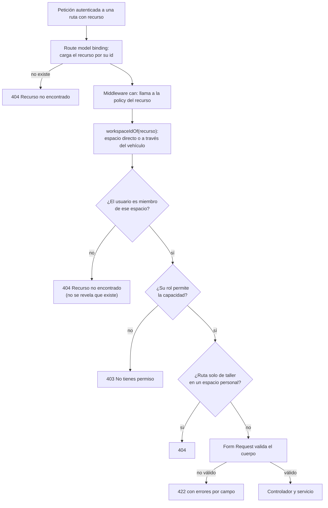

- **404 y no 403 ante un recurso ajeno.** Un 403 confirmaría que el identificador existe y pertenece a otro. `WorkspaceScopedPolicy::check()` devuelve `Response::denyAsNotFound()` cuando `User::roleIn()` es `null`. Este patrón es habitual en aplicaciones multiinquilino.
- **La autorización precede a la validación.** El middleware `can:` se ejecuta antes de que Laravel resuelva el *Form Request* del controlador. Por eso una petición con un cuerpo inválido contra un recurso ajeno recibe 404 y no 422, que también delataría su existencia. El diseño del 21/10 dejaba esta cuestión abierta ([`docs/tfg/04`](../04-arquitectura.md), "Orden de validación y autorización"); `IsolationTest` la comprueba enviando cuerpos incompletos a las 58 rutas con recurso (capítulo 8).
- **Sin caché del rol.** `User::roleIn()` consulta `workspace_user` en cada petición, de modo que un cambio de rol o una expulsión se aplica en la siguiente petición.
- **El cliente no decide.** La SPA tiene su propia tabla de capacidades (`frontend/src/lib/permissions.ts`) solo para ocultar controles que el usuario no puede usar; su comentario lo dice expresamente: "La autorización real la hace el servidor; esto solo decide qué mostrar".

## 6.4 Modelo de datos

### Diagrama entidad‑relación

El diagrama recoge las 15 tablas del dominio tal como las crean las migraciones `2026_10_21_000001…000003`. Los tipos son los de Laravel (`string` = `VARCHAR`, `bigint` = `BIGINT UNSIGNED` en las claves). No se dibujan las tablas de infraestructura (`sessions`, `password_reset_tokens`, `cache`, `jobs`…): `sessions` guarda las sesiones de Sanctum y `password_reset_tokens` la usará la recuperación de contraseña (ADR‑0006).

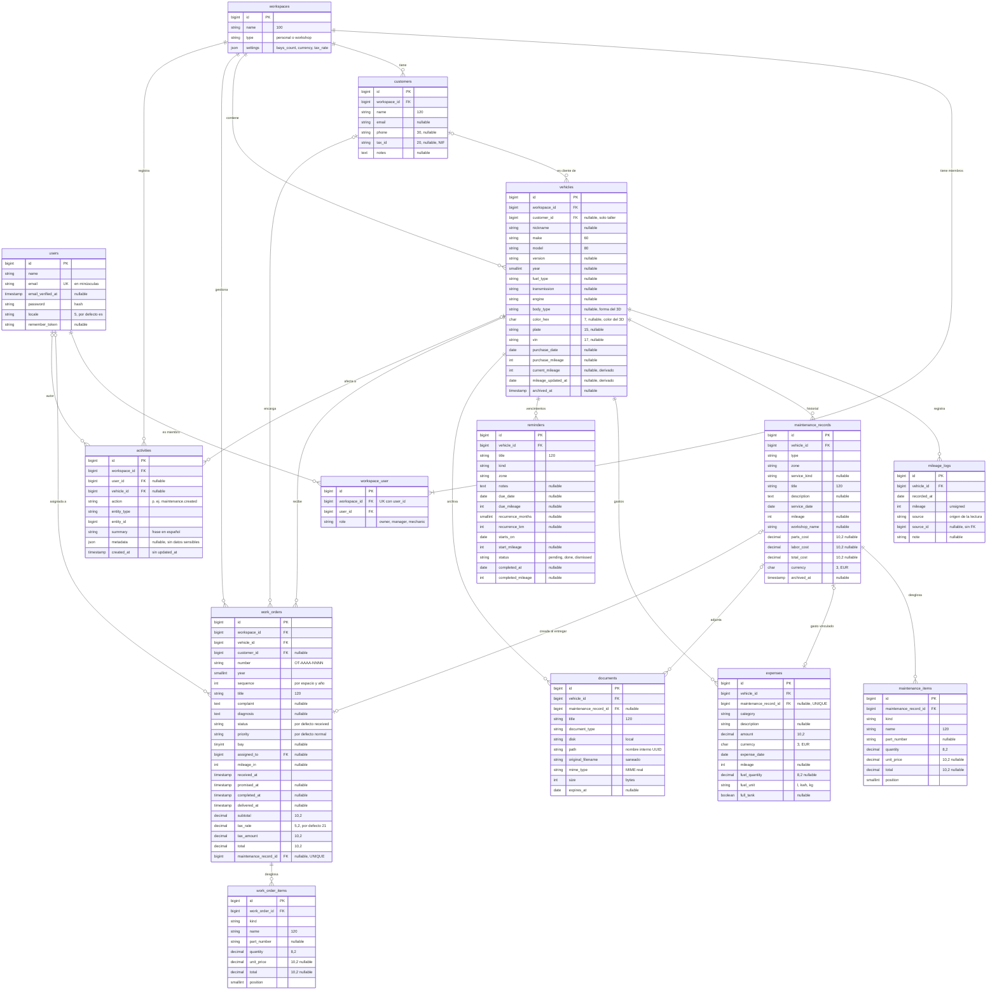

*Todas las tablas salvo `activities` tienen `created_at` y `updated_at`; se omiten en el diagrama para que se lea mejor. La lista completa de columnas y tipos, con sus longitudes, está en [`docs/tfg/03-modelo-de-datos.md`](../03-modelo-de-datos.md), §3.1, y coincide con las migraciones a 26/10/2026.*

> [PENDIENTE: tarea 29 — la columna `customers.anonymized_at` (ADR‑0005) aún no tiene migración. `CustomerResource` ya la incluye en el JSON desde el 25/10 (commit `92ad333`), siempre con valor `null`, para cumplir la forma del contrato.]

### Cardinalidades y reglas de borrado

| Relación | Cardinalidad | Regla |
|----------|--------------|-------|
| Usuario ↔ espacio (`workspace_user`) | N:M | Un usuario tiene al menos su espacio personal; un espacio tiene al menos un propietario (regla de servicio) |
| Espacio → vehículos, clientes, órdenes, actividad | 1:N | Borrar el espacio borra en cascada su contenido |
| Cliente → vehículos y órdenes | 0..1:N | Solo en talleres. Al borrar el cliente, sus vehículos y órdenes quedan sin cliente (`nullOnDelete`) |
| Vehículo → lecturas, intervenciones, gastos, recordatorios, documentos, órdenes | 1:N | Cascada al eliminar el vehículo, que antes debe estar archivado |
| Intervención → líneas | 1:N (máx. 50) | Al editar, las líneas enviadas sustituyen a las anteriores |
| Intervención ↔ gasto | 0..1:0..1 | `expenses.maintenance_record_id` es único: como mucho un gasto vinculado por intervención |
| Orden ↔ intervención | 0..1:0..1 | `work_orders.maintenance_record_id` es único y se rellena al entregar |
| Usuario → órdenes asignadas | 0..1:N | Si se quita al miembro o se borra el usuario, la orden queda sin asignar |

### Decisiones del modelo y su porqué

**Propiedad a través del espacio.** Las tablas hijas no guardan `user_id`; la propiedad se resuelve recurso → vehículo → espacio → miembros. La migración de vehículos lo explica en su cabecera. Si cada fila guardara a su dueño, podría desincronizarse al añadir un mecánico al taller. El precio es que la autorización recorre una o dos relaciones, lo que se compensa con índices que empiezan por `workspace_id` o `vehicle_id`.

**Dinero en `DECIMAL` y como texto en JSON.** Importes en `DECIMAL(10,2)`, cantidades en `DECIMAL(8,2)` y tipo de IVA en `DECIMAL(5,2)`. En JSON viajan como cadena (`"1234.50"`) y en PHP la aritmética se hace en céntimos enteros (`App\Support\Money`). La coma flotante binaria no representa con exactitud valores como 0,10 €, y la suma de cientos de gastos acumularía error; enviar texto evita además que JavaScript los convierta a `number` antes de formatearlos (regla de oro 4).

**Enumerados como texto.** Los 18 enumerados se guardan en columnas `VARCHAR` y se convierten a *backed enums* de PHP en el modelo (`app/Enums/`). Añadir un valor no exige reescribir la tabla, la validación usa el propio enumerado y las pruebas sobre SQLite se comportan igual que en MariaDB. El contrato TypeScript tiene las mismas uniones de literales, y una prueba comprueba que coinciden (capítulo 8).

**Archivar antes de borrar.** Vehículos e intervenciones tienen `archived_at`. Archivar oculta el registro pero conserva el historial; un vehículo solo se elimina si antes se archivó, como doble paso ante una acción irreversible. La matrícula y el VIN no tienen índice único en la base de datos porque la unicidad se exige solo entre vehículos no archivados del mismo espacio, y MariaDB no admite índices parciales; se valida en la aplicación.

**Kilometraje: las lecturas mandan.** `mileage_logs` guarda cada lectura con su origen (`source`, `source_id`). `vehicles.current_mileage` es una caché derivada: la lectura más reciente por fecha y, a igual fecha, la de más km. Se acepta esta redundancia porque los listados necesitan el km de muchos vehículos a la vez, y porque un único servicio (`MileageService`) escribe las lecturas y recalcula la caché. `source_id` es una referencia polimórfica sin clave foránea (puede apuntar a una intervención, un gasto, una orden o un recordatorio); el índice `(source, source_id)` permite encontrar la lectura de cada origen.

**Gasto vinculado.** Ver ADR‑0003 y §6.6.2. La clave foránea `expenses.maintenance_record_id` es única y con `cascadeOnDelete`.

**Elevadores sin tabla.** Los elevadores son los números de 1 a `settings.bays_count`; su ocupación se deduce de `work_orders.bay` en las órdenes abiertas. La regla "un elevador, una orden abierta" depende del estado, así que no se puede expresar con un índice único en MariaDB; la garantiza el servicio con un bloqueo (§6.6.3).

**Numeración de órdenes.** Se guardan `year` y `sequence` además del texto `number`. Los índices únicos `(workspace_id, year, sequence)` y `(workspace_id, number)` son la última defensa contra duplicados; el número siguiente se calcula como `máx(sequence) + 1` bajo bloqueo.

**Dos tablas de líneas gemelas.** `maintenance_items` y `work_order_items` tienen la misma forma. Una tabla polimórfica no permitiría claves foráneas reales con borrado en cascada (comentario de la migración). Al entregar una orden, sus líneas se copian a la intervención: el historial del vehículo queda como copia fija de lo que se hizo.

**Un solo enlace entre orden e intervención.** Solo existe `work_orders.maintenance_record_id`. El `work_order_id` que expone la intervención en el JSON se obtiene por la relación inversa, de modo que no hay dos columnas que puedan contradecirse.

### Índices

Además de las claves primarias, foráneas y únicas, las migraciones crean índices compuestos en las columnas por las que se filtra y ordena, por ejemplo `(vehicle_id, service_date)` en el historial, `(vehicle_id, recorded_at, mileage)` en las lecturas o `(workspace_id, status)` y `(workspace_id, bay)` en las órdenes. La migración `2026_10_24_000001_add_listing_indexes.php` (tarea 19, rendimiento) añadió tres más, sin cambiar columnas ni datos: `work_orders (workspace_id, received_at)`, `vehicles (workspace_id, archived_at, created_at)` y `documents (vehicle_id, created_at)`. La lista completa está en [`docs/tfg/03`](../03-modelo-de-datos.md), §3.5.

## 6.5 Diagramas de clases

### Modelo de dominio

Clases Eloquent de `backend/app/Models/` con sus atributos más significativos y los métodos que existen en el código. La pivote `workspace_user` no es un modelo propio: se maneja con `belongsToMany(...)->withPivot('role')`, y aquí se dibuja como `Membership` para mostrar el rol.

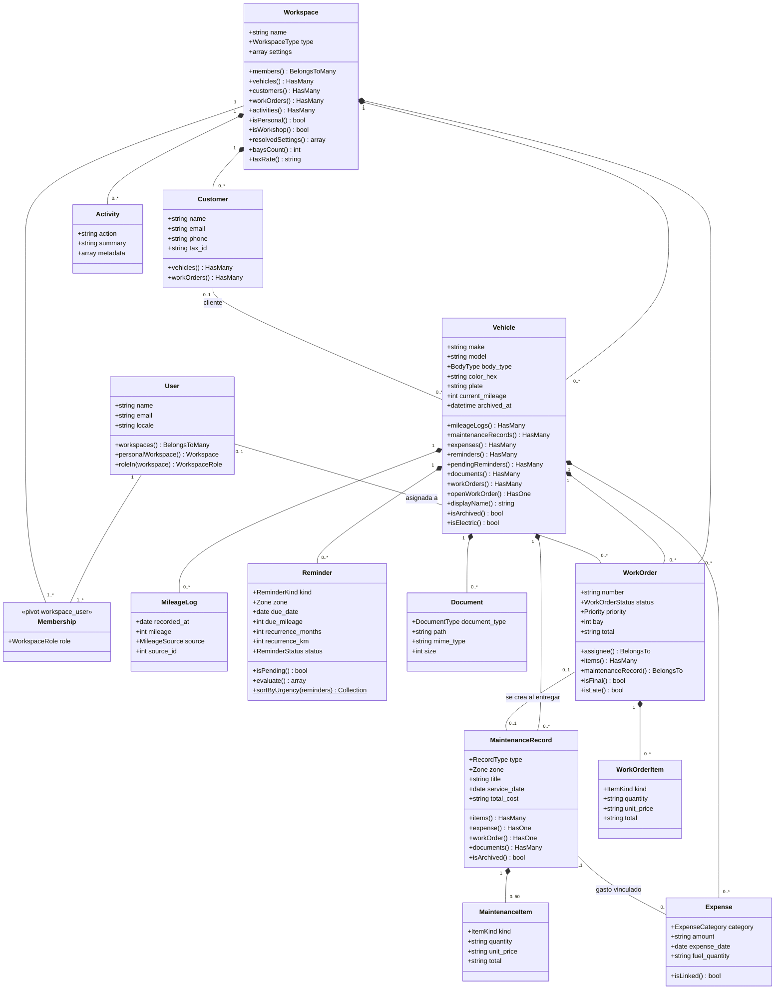

Valores que se calculan al consultar y no se guardan: el estado, los días y km restantes y el progreso de un recordatorio (`Reminder::evaluate()`), el estado de cada zona (`ZoneService`), la ocupación de los elevadores (`WorkOrderService::bays()`), el retraso de una orden (`WorkOrder::isLate()`), si un gasto está vinculado (`Expense::isLinked()`) y el nombre visible del vehículo (`Vehicle::displayName()`).

**Lógica pequeña en los enumerados.** Algunas reglas estables viven junto al valor al que se refieren: qué categoría de gasto corresponde a cada tipo de intervención (`RecordType::expenseCategory()`), la zona por defecto de cada tipo de recordatorio (`ReminderKind::defaultZone()`), qué estados de orden son finales o liberan el elevador (`WorkOrderStatus::isFinal()` y `releasesBay()`), la gravedad con la que se ordena el estado de las zonas (`ReminderState::severity()`) y la tabla de permisos (`WorkspaceRole::allows()`). Los 18 enumerados comparten el *trait* `EnumHelpers::values()`, que usan las reglas de validación.

### Servicios, *policies* y utilidades

Los 17 servicios de `backend/app/Services/` y sus dependencias, tomadas de sus constructores. Laravel las inyecta con su contenedor de servicios.

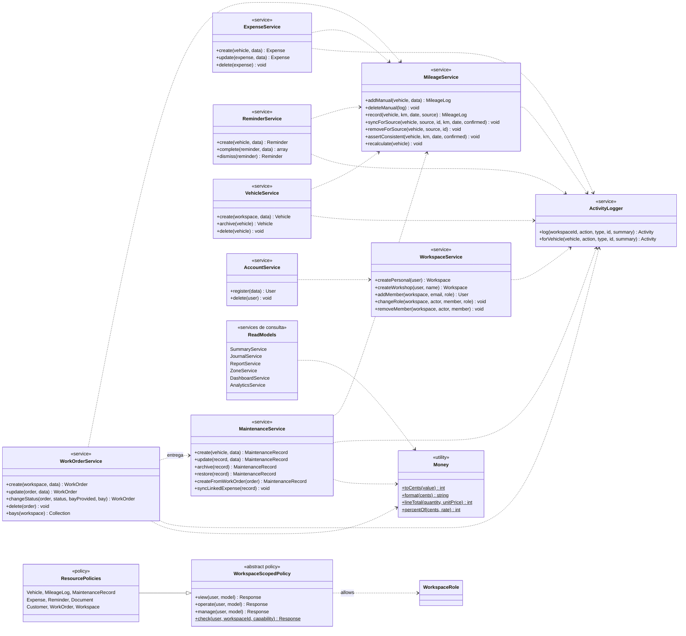

Hay dos familias de servicios. Los de **escritura** (`MileageService`, `MaintenanceService`, `ExpenseService`, `ReminderService`, `WorkOrderService`, `VehicleService`, `WorkspaceService`, `AccountService`, `CustomerService`, `DocumentService`) abren transacciones y registran la actividad. Los de **consulta** (`SummaryService`, `JournalService`, `ReportService`, `ZoneService`, `DashboardService`, `AnalyticsService`) calculan resúmenes a partir de los datos sin modificarlos. Esta separación no la impone ningún patrón formal; surgió de que las vistas derivadas (resumen, diario, informe, panel, analítica) tienen reglas propias de cálculo y de "faltan datos" que no conviene mezclar con las de escritura.

| Servicio | Responsabilidad | Requisitos |
|----------|-----------------|------------|
| `MileageService` | Único punto que escribe lecturas y la caché `current_mileage`; control de retrocesos | RF-23…RF-26 |
| `MaintenanceService` | Intervención, líneas, lectura y gasto vinculado en una transacción; archivar y restaurar; intervención al entregar una orden | RF-27…RF-32, RF-65 |
| `ExpenseService` | Gastos manuales; 409 sobre los vinculados | RF-33…RF-35 |
| `ReminderService` | Alta, edición, completar con recurrencia, descartar | RF-41…RF-45 |
| `WorkOrderService` | Numeración sin huecos, elevadores, totales con IVA, cambios de estado y entrega | RF-62…RF-68 |
| `WorkspaceService`, `AccountService` | Espacios, miembros y roles; registro y baja de la cuenta | RF-03, RF-09, RF-11…RF-15 |
| `DocumentService` | Almacenamiento privado, nombre saneado, borrado del fichero | RF-53…RF-56 |
| `SummaryService`, `JournalService`, `ReportService` | Resumen por periodo, coste por km, consumo, diario e informe | RF-36…RF-39, RF-58, RF-59 |
| `ZoneService` | Estado de las 10 zonas según los recordatorios | RF-46 |
| `DashboardService`, `AnalyticsService` | Panel de inicio, centro de control y analítica del espacio | RF-40, RF-57, RF-69 |
| `ActivityLogger` | Registro de actividad con una frase en español y sin datos sensibles | RF-60 |

## 6.6 Diagramas de secuencia

Convenciones: flecha continua, petición o llamada; discontinua, respuesta. Las cajas sombreadas son transacciones de base de datos: o se confirma todo o no se guarda nada. Las peticiones de la SPA pasan por el proxy de Vite en desarrollo; solo se dibuja en el primer diagrama.

### 6.6.1 Inicio de sesión con Sanctum en modo SPA

Requisitos RF-04, RF-06 y RNF-01. Código: `AuthController::login()`, `LoginRequest::authenticate()`, `frontend/src/api/client.ts`.

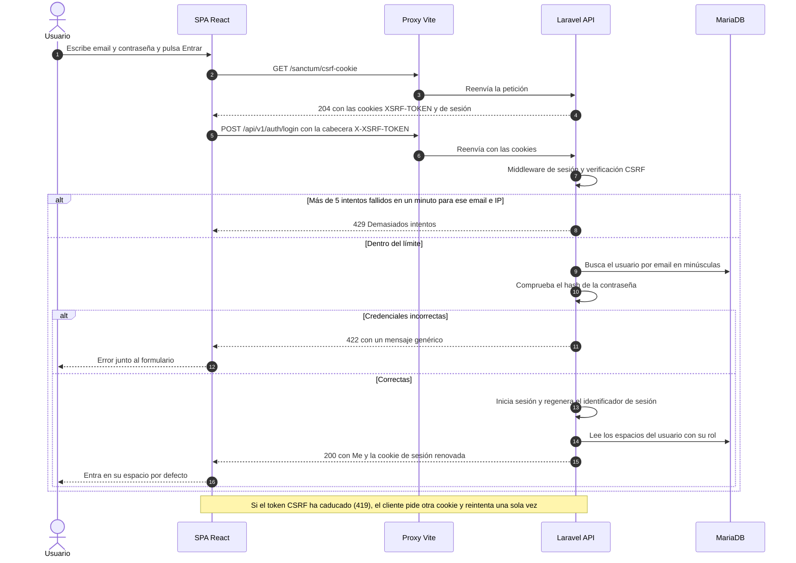

La cookie de sesión es *HttpOnly* (JavaScript no puede leerla) y el token CSRF impide que otra web envíe peticiones en nombre del usuario. No se guarda ningún token en `localStorage`, lo que reduce el daño de un posible XSS. Regenerar la sesión al entrar evita la fijación de sesión, y el mensaje genérico no revela si el email existe.

### 6.6.2 Registrar una intervención con coste (gasto vinculado)

Requisitos RF-26…RF-29, caso de uso CU-02, ADR‑0003. Código: `MaintenanceController::store()`, `MaintenanceService::create()`, `MileageService::syncForSource()`.

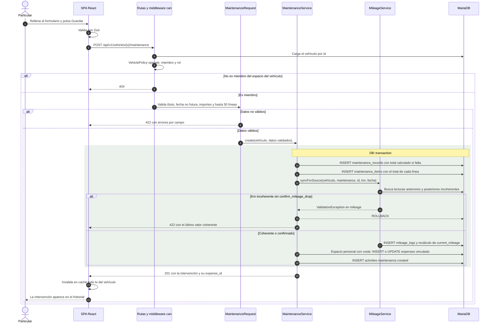

- Intervención, líneas, lectura, gasto vinculado y actividad se confirman juntos: no puede quedar un gasto sin intervención ni una intervención con coste sin su gasto.
- Si el km no cuadra, la SPA muestra el mensaje del servidor con una casilla de confirmación y repite la petición con `confirm_mileage_drop: true` (CU-03).
- El mismo `syncLinkedExpense()` se llama al editar, archivar y restaurar: sin coste o archivada, el gasto se borra; restaurada, se recrea.

### 6.6.3 Entregar una orden de trabajo

Requisitos RF-64 y RF-65, caso de uso CU-07. Código: `WorkOrderController::status()`, `WorkOrderService::changeStatus()`, `MaintenanceService::createFromWorkOrder()`.

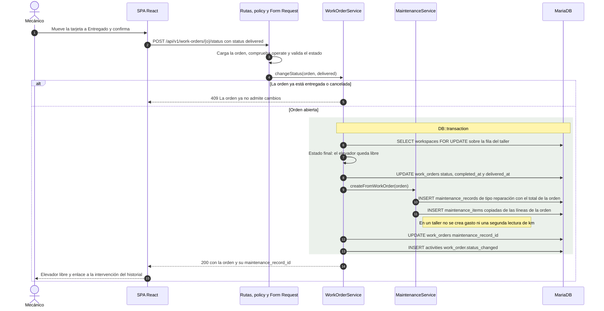

El bloqueo se toma sobre la **fila del taller**, no sobre la de la orden, como suponía el diseño del 21/10. Así se serializan dentro de un taller todas las operaciones que tocan la numeración o los elevadores (crear, editar y cambiar de estado), y dos peticiones simultáneas no pueden asignar el mismo elevador ni obtener el mismo número. En MariaDB el bloqueo es real; SQLite, que usan las pruebas, lo ignora, por lo que no hay todavía una prueba de concurrencia con dos procesos (capítulo 8).

### 6.6.4 Ciclo de vida de una orden de trabajo

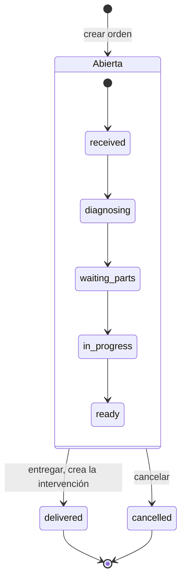

Entre los cinco estados abiertos el movimiento es libre en los dos sentidos (tablero kanban); el diagrama muestra el recorrido habitual. Pasar a `ready` fija `completed_at`; volver a un estado anterior lo borra. `ready` libera el elevador salvo que se indique otro; `delivered` y `cancelled` lo liberan siempre y son finales: cualquier cambio posterior responde 409.

### 6.6.5 Recuperar la contraseña (diseño)

> Diseño aprobado en el contrato (§3.1.1) y en ADR‑0006 el 24/10/2026. [PENDIENTE: tarea 28 — las rutas `auth/forgot-password` y `auth/reset-password` no están en el commit `e530d3e`. El 26/10 había en el árbol de trabajo, sin confirmar ni verificar, `PasswordResetController`, `PasswordResetService`, una notificación y `PasswordResetTest`. Revisar este diagrama contra el código cuando la tarea se cierre.]

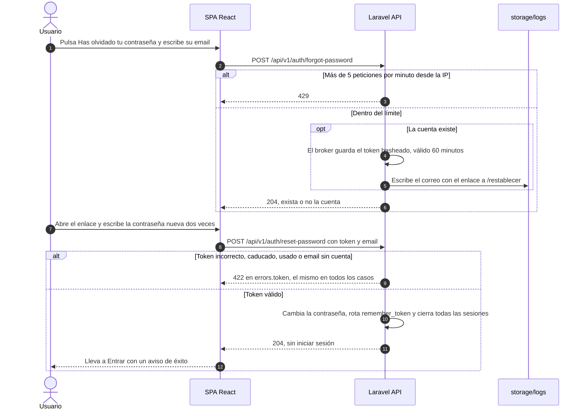

La respuesta igual exista o no la cuenta evita la enumeración de emails; el límite de peticiones y la caducidad del token dificultan la fuerza bruta; y cerrar todas las sesiones expulsa a quien tuviera la contraseña antigua. El correo se escribe en el registro local por decisión del autor (D17): para un servidor de correo real solo cambia la configuración del *mailer*.

## 6.7 Diseño de la interfaz

### Mapa de pantallas

Rutas de `frontend/src/app/router.tsx`. Todas las pantallas se cargan de forma diferida con `lazy()`, cada una en su propio *chunk*. Las rutas bajo `/app` exigen sesión (`RequireAuth`); las de entrar y registrarse solo se muestran sin sesión (`GuestOnly`).

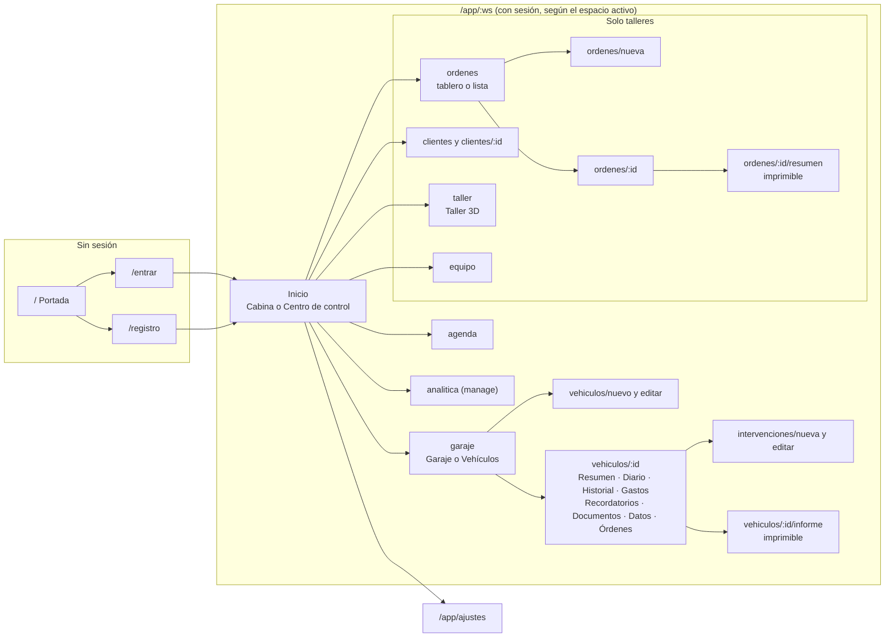

El menú lateral (y la barra inferior en el móvil) cambia con el tipo de espacio activo (`frontend/src/components/layout/nav.ts`). En un espacio personal muestra Cabina, Garaje, Agenda y, con la capacidad `manage`, Analítica. En un taller muestra Centro de control, Órdenes, Clientes, Vehículos, Taller 3D, Agenda de flota, Equipo y, con `manage`, Analítica. El informe del vehículo y el resumen de la orden quedan fuera del marco de la aplicación para que se impriman limpios.

### Principios de diseño de la interfaz

- **Ningún dato sin fuente** (regla de oro 2). Si falta un dato para un cálculo, la pantalla dice cuál falta y ofrece la acción que lo resuelve; el estado de las zonas se rotula "según tus intervalos, no medido" y la vista de rayos X, "Ilustrativo".
- **Ningún control decorativo** (regla de oro 5) y confirmación antes de las acciones destructivas.
- **Accesible y adaptable** (regla de oro 6): teclado, foco visible, contraste AA, `prefers-reduced-motion` y tres anchos de referencia (360, 768 y 1280 px). Todo lo que muestra el 3D existe también en HTML.
- **Componentes base** sobre primitivas accesibles de Radix (diálogos, menús, pestañas, *tooltips*), estilos con Tailwind 4 y variables CSS propias, tema claro y oscuro, y tipografías libres autoalojadas (Inter y Space Grotesk, paquetes `@fontsource`).

**Simplificación en curso.** El 23/10/2026 el autor pidió una interfaz menos cargada. La auditoría de `disenador-ux` midió 34 pantallas y propuso 14 reglas comprobables (R1‑R14): una sola acción primaria por pantalla, como máximo tres cifras grandes, nada de caja dentro de caja, datos en listas y tablas, píldoras solo para lo que pide atención, sin mayúsculas espaciadas, superficies planas, el aviso de honestidad una vez por sección y el 3D solo donde aporta ([informe de UX](../../equipo/informes/2026-10-23-disenador-ux-simplificacion.md), apartado 4). La dirección visual definitiva la elegirá el autor entre tres propuestas (pregunta 4 del tablero, tarea 18).

> [PENDIENTE: tarea 16, paso 2 — aplicar el plan por pantalla. Este apartado se completará con capturas de la interfaz final y la dirección visual elegida (tarea 18).]

### Dónde hay 3D y con qué alternativa

| Pantalla | Componente | En el código a 26/10 | Alternativa sin WebGL | Plan de UX (§5.7) |
|----------|------------|----------------------|-----------------------|-------------------|
| Ficha · Resumen (mapa de zonas) | `CarViewer` modo `inspect` | Sí, con selector "3D / Lista" | Silueta SVG y lista de zonas en HTML | Se queda |
| Taller 3D | `WorkshopScene` | Sí | `Workshop2D`, lista de elevadores | Se queda |
| Formulario de vehículo | `CarPreview` | Sí | Silueta SVG | Solo en el paso "Aspecto" |
| Cabina (inicio del particular) | `CarViewer` modo `showcase` | Sí | Silueta SVG | Se quita |
| Centro de control (taller) | `WorkshopScene` | Sí | `Workshop2D` | Se quita: tabla de elevadores y enlace a Taller 3D |
| Portada | `HeroScene` | Sí | Silueta SVG | Imagen fija |
| Listados y cabeceras | `CarThumbnail` | Silueta SVG, sin three.js (desde el 25/10) | — | Hecho |

La columna "En el código a 26/10" se ha comprobado buscando los componentes en `frontend/src/features/` y `components/`. El plan de reducir el 3D a la ficha y al taller está decidido pero sin aplicar (tarea 16).

## 6.8 Diseño del módulo 3D

El módulo 3D está aislado tras una interfaz pública (`frontend/src/three/index.tsx` y `types.ts`), que es el contrato entre el agente `experto-3d` y el resto de la SPA. Las pantallas solo importan desde `@/three` y solo usan las *props* declaradas, de modo que el 3D se puede sustituir o desactivar sin tocarlas.

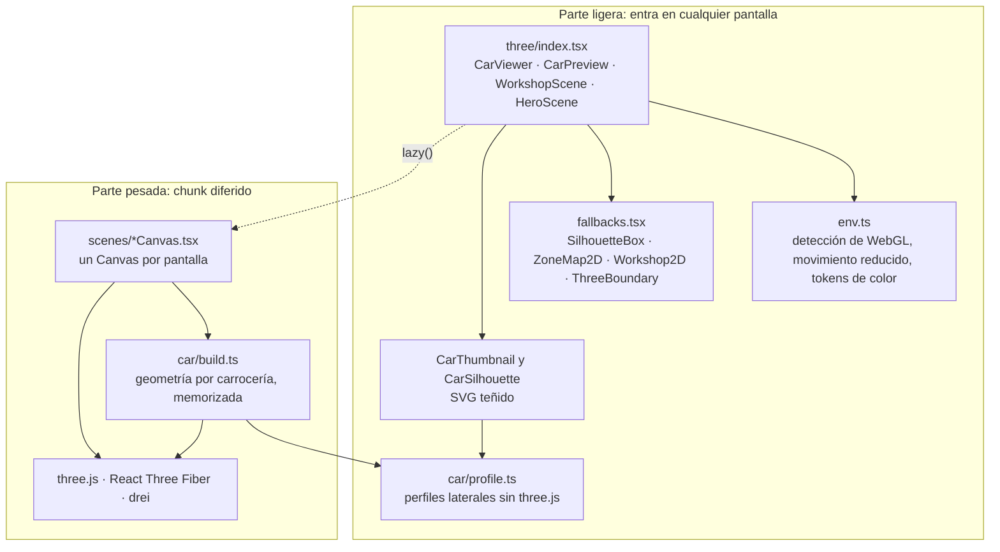

Cada envoltorio público decide en tiempo de ejecución: si el navegador no puede crear un contexto WebGL (`useWebGLAvailable()`), muestra el respaldo 2D; si puede, carga la escena con `lazy()` y muestra la silueta mientras llega; y si la escena falla, un límite de errores (`ThreeBoundary`) vuelve al respaldo. Los perfiles laterales de cada carrocería (`car/profile.ts`) no dependen de three.js y los usan a la vez el modelo 3D y la silueta SVG, de modo que las dos representaciones tienen exactamente la misma forma. El capítulo 7 (§7.6) describe la generación y las medidas de rendimiento.

## 6.9 Cambios respecto al diseño del 21/10/2026

| Punto | Diseño del 21/10 (`docs/tfg/03…06`) | Código a 26/10 |
|-------|--------------------------------------|----------------|
| Orden de autorización y validación | Pregunta abierta: si se validaba antes, un recurso ajeno podía dar 422 | Resuelto: `->can()` en cada ruta se ejecuta antes del *Form Request*; `IsolationTest` lo comprueba |
| Servicios | `VehicleSummaryService` y `ZoneStatusService` | Las vistas derivadas se reparten en `SummaryService`, `JournalService`, `ReportService`, `DashboardService` y `AnalyticsService`; el de zonas se llama `ZoneService`. Hay además `ExpenseService`, `VehicleService`, `WorkspaceService`, `AccountService` y `CustomerService` |
| `MileageService` | `record()`, `delete()`, `recalculate()` | Además `addManual()`, `deleteManual()` (409 si no es manual), `syncForSource()` y `removeForSource()` para mantener una lectura por origen, y `assertConsistent()` público |
| `DocumentService` | Incluía `stream()` para descargar | La descarga la hace `DocumentController::download()` con las cabeceras de seguridad; el servicio guarda y borra |
| Bloqueo al entregar una orden | `SELECT work_orders FOR UPDATE` | `SELECT workspaces FOR UPDATE` sobre la fila del taller, en crear, editar y cambiar de estado. La comprobación de orden final (409) se hace antes de abrir la transacción |
| Lectura de km al entregar | Pendiente de aclarar | No se crea una segunda lectura: ya existe la de `mileage_in` al crear la orden (`createFromWorkOrder()` lo documenta) |
| Estado de las clases | Servicios y *policies* "pendientes de verificar" | Existen 17 servicios, 9 *policies* con su clase base, 14 controladores y 13 modelos; los diagramas de §6.5 se han redibujado desde el código |
| Miniaturas | Imagen estática "render cacheado o silueta" | Hasta el 24/10 se pintaban con un renderizador WebGL compartido; desde el 25/10 son siluetas SVG sin three.js (commit `d8a31bb`) |
| Índices | Los de las tres migraciones del 21/10 | Tres índices más el 24/10 (`2026_10_24_000001_add_listing_indexes.php`) |
| Base de datos de los diagramas | "MySQL" | MariaDB 10.4 (XAMPP); las pruebas se han ejecutado también sobre ella (capítulo 8) |
| Despliegue | Por decidir | Sigue por decidir (D14, capítulo 9) |
