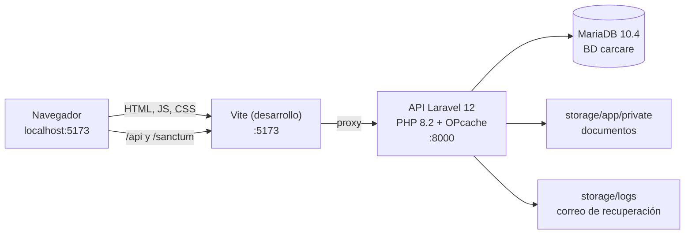

# 9. Despliegue

Este capítulo describe dónde se ejecuta CarCare hoy, cómo se publica el código y qué haría falta para ponerlo en un servidor. A 26/10/2026 la aplicación **no está desplegada en ningún servidor**: se ejecuta en local, en el equipo del autor. La forma de enseñarla en la defensa es la decisión D14, que sigue abierta porque depende de la guía de Ilerna (D1).

## 9.1 Entorno actual: ejecución en local

La aplicación funciona en un portátil con Windows 11 y XAMPP, que aporta PHP 8.2.12 y MariaDB 10.4.32 (capítulo 7, §7.1). Se arranca con `iniciar-carcare.bat` o a mano, como explica el capítulo 10 (§10.4). En ese modo hay tres procesos:

*Tabla 9.1. Procesos de la ejecución en local.*

| Proceso | Puerto | Qué hace | Archivo |
|---------|--------|----------|---------|
| MariaDB (XAMPP) | 3306 | Base de datos `carcare` | — |
| API Laravel con OPcache | 8000 | Atiende `/api/v1/*` y `/sanctum/csrf-cookie` | `scripts/servidor-api.cmd` |
| Servidor de desarrollo de Vite | 5173 | Sirve la SPA y reenvía `/api` y `/sanctum` a la API | `frontend/vite.config.ts` |

*Figura 9.1. Despliegue en local: el navegador solo habla con Vite, que reenvía a la API.*

Tres características de este montaje condicionan cualquier despliegue posterior:

- **Mismo origen.** El navegador solo conoce `localhost:5173`. Como Vite reenvía las peticiones a la API, la cookie de sesión de Sanctum funciona sin configurar CORS (capítulo 6, §6.1). En el repositorio no hay `config/cors.php`, así que un despliegue debe conservar el mismo origen (web y API bajo el mismo dominio) o publicar y configurar CORS con credenciales.
- **Un servidor de PHP de una sola petición a la vez.** `scripts/servidor-api.cmd` usa el servidor integrado de PHP (`php -S`) con OPcache activado solo para ese proceso. Sin OPcache cada petición tardaba unas diez veces más (medido el 23/10/2026, capítulo 10). Este servidor sirve para desarrollar y para una demostración de una sola persona, pero no para varios usuarios a la vez.
- **Sin servicios externos.** El correo de recuperación de la contraseña se escribe en `storage/logs` (`MAIL_MAILER` vale `log` por defecto en `config/mail.php`; decisión D17 = A). Los documentos se guardan en `storage/app/private` (disco `local`). Las notificaciones se envían en el momento, sin colas: ninguna clase de `backend/app` implementa `ShouldQueue`, así que no hace falta un proceso trabajador.

## 9.2 Publicación del código en GitHub

El código está en un repositorio **privado** de GitHub, `albertomanana/carcare`, publicado el 24/10/2026 (tarea 0 de la cola del equipo, `docs/equipo/AUTOPILOTO.md`). Lo crea el script `scripts/github/publicar-repo.sh`, que es idempotente: crea el repositorio con `gh repo create --private`, sube `main` y `develop` y deja `main` como rama por defecto.

El flujo de ramas está en `CONTRIBUTING.md`:

*Tabla 9.2. Ramas permanentes del repositorio.*

| Rama | Uso | Estado a 26/10/2026 |
|------|-----|---------------------|
| `main` | Versión estable que se enseña al tutor o al tribunal. Solo cambia por *pull request* desde `develop` al cerrar un hito, y cada vez se etiqueta | 1 commit (`6090ee2`, README y normas de contribución). Sin etiquetas |
| `develop` | Trabajo diario. Cada sesión termina con un commit por área y `git push origin develop` | 36 commits; el último en el remoto es `08bdc08` (26/10/2026, 13:51) |

Los hitos que llevan `develop` a `main` también están fijados en `CONTRIBUTING.md`:

*Tabla 9.3. Hitos de publicación en `main`.*

| Etiqueta | Hito | Criterio de cierre | Estado |
|----------|------|--------------------|--------|
| `v0.1` | Primera versión mostrable | Todas las pantallas con datos reales; pruebas del backend y *build* del frontend en verde | Pendiente de la integración (tarea 5) |
| `v0.2` | Calidad | E2E, auditoría de seguridad y revisión de accesibilidad con los hallazgos críticos corregidos | Pendiente (tareas 6, 7 y 8) |
| `v0.3` | Documentación del TFG | Memoria, diagramas y manuales al día con el código | Pendiente (tarea 10) |
| `v1.0` | Entrega del TFG | Versión que se entrega y se defiende | ⚠️ Depende de Ilerna (fecha de entrega) |

El repositorio tiene una plantilla de *pull request* (`.github/pull_request_template.md`), pero **no tiene integración continua**: no existe `.github/workflows/` (tarea 11, capítulo 8).

> [PENDIENTE: tarea 11 — cuando exista el flujo de GitHub Actions, describir aquí qué ejecuta (pruebas del backend, *typecheck*, *lint*, pruebas y *build* del frontend) y enlazar su primera ejecución en verde.]

## 9.3 Opciones para la defensa (decisión D14)

La decisión D14 de `CarCare/03_decisiones/registro-decisiones.md` recoge tres opciones. El autor no la ha tomado todavía: depende de si Ilerna exige una URL pública (D1) y de si las pruebas con usuarios serán en remoto (capítulo 12).

*Tabla 9.4. Opciones de despliegue para la defensa (D14).*

| Opción | Ventajas | Inconvenientes |
|--------|----------|----------------|
| **A. En local, en el portátil (XAMPP), con un vídeo de respaldo** | Es el entorno en el que se han ejecutado todas las pruebas; sin coste; sin cambios en el código | Depende de un único equipo; el tribunal no puede probarla después |
| B. *Hosting* compartido con PHP y MySQL | URL pública con un coste bajo | Suele limitar la versión de PHP, las tareas programadas y la configuración del servidor web; hay que comprobar que admite Laravel 12 |
| C. Servidor privado virtual (VPS) | Control total (PHP, servidor web, HTTPS, copias) | Coste mensual y tareas de administración que no forman parte del objetivo del TFG |

**Recomendación: opción A**, que es también el mínimo que fija D14. Se apoya en dos razones. La primera, que todas las cifras de esta memoria (pruebas, tiempos) se han obtenido en ese entorno, y enseñar la aplicación en otro introduciría variables que no se han medido. La segunda, que un despliegue público exige antes la auditoría de seguridad (tarea 7), un servicio de correo real y una política de privacidad, y ninguna de las tres existe todavía (capítulo 13, §13.4). B o C solo tienen sentido si Ilerna pide una URL pública o si las pruebas con usuarios se hacen en remoto.

> ⚠️ Depende de Ilerna (D1). [PENDIENTE: D14 — decisión de Alberto. Si se elige B o C, este capítulo se amplía con el procedimiento real seguido y sus comprobaciones.]

### Preparación de la demostración en local

Lista de comprobación propuesta para el día de la defensa. Usa solo órdenes que ya existen:

1. Arrancar con `iniciar-carcare.bat` y comprobar que `http://127.0.0.1:8000/api/v1/health` responde `{"status":"ok"}` (capítulo 10, §10.4).
2. Poner al día los datos de demostración con `php artisan db:seed`. El *seeder* es aditivo e idempotente: no borra nada, rellena lecturas, repostajes y gastos hasta el día de hoy y hace avanzar las órdenes del taller un paso (capítulo 7, §7.7). Así las fechas de la demostración coinciden con la fecha de la defensa.
3. Entrar con las cuatro cuentas de demostración (capítulo 10, §10.5) y recorrer el guion de la demostración.
4. Tener a mano el **vídeo de respaldo**, grabado antes con el mismo guion, por si falla el equipo o el proyector.

> [PENDIENTE: tarea 31 — guion de la demostración en vivo y guion del vídeo de respaldo. El vídeo no se ha grabado.]

## 9.4 Qué exigiría un despliegue en un servidor

No se ha hecho ningún despliegue, así que esta sección no describe un procedimiento probado. Recoge, a partir de la configuración real del repositorio, los cambios que serían necesarios. Sirve como lista de trabajo si D14 se resuelve con B o C, y como respuesta a la pregunta previsible del tribunal sobre la puesta en producción.

*Tabla 9.5. Cambios necesarios para un despliegue en servidor, según la configuración actual.*

| Aspecto | Hoy (local) | En un servidor | Dónde está en el código |
|---------|-------------|----------------|-------------------------|
| Entorno | `APP_ENV=local` | `APP_ENV=production` y `APP_DEBUG=false`. Con `production`, `DatabaseSeeder` y `DemoSeeder` se niegan a cargar datos de demostración | `backend/database/seeders/DatabaseSeeder.php`, `DemoSeeder.php` |
| Frontend | Servidor de desarrollo de Vite | Ficheros estáticos de `npm run build` (`frontend/dist/`) servidos por el servidor web | `frontend/package.json` |
| Mismo origen | El *proxy* de Vite | El servidor web sirve `dist/` y reenvía `/api` y `/sanctum` a `backend/public/index.php` | `frontend/vite.config.ts` |
| Sesión | Cookie sin `Secure` | HTTPS obligatorio, `SESSION_SECURE_COOKIE=true` y `SANCTUM_STATEFUL_DOMAINS` con el dominio real | `backend/config/session.php`, `backend/config/sanctum.php` |
| Enlace de recuperación | `FRONTEND_URL` vale `http://localhost:5173` por defecto | La URL pública de la web | `backend/config/app.php` (`frontend_url`) |
| Correo | Se escribe en el registro (`log`) | Un servicio SMTP real, con su política de privacidad | `backend/config/mail.php` |
| Documentos | `storage/app/private` en el disco local | Disco persistente con copia de seguridad, fuera de la carpeta pública | `backend/config/filesystems.php` |
| Servidor PHP | `php -S` con OPcache, una petición a la vez | PHP‑FPM con OPcache detrás de Nginx o Apache | `scripts/servidor-api.cmd` |
| Base de datos | MariaDB 10.4 de XAMPP, usuario `root` sin contraseña | Usuario propio con contraseña y permisos mínimos; `php artisan migrate --force`; copias de seguridad programadas | `backend/config/database.php` |
| Rendimiento de arranque | Sin cachés | `php artisan config:cache` y `route:cache` | — |
| Versiones | PHP 8.2 (soporte de seguridad hasta el 31/12/2026) | Valorar PHP 8.3 o superior y Laravel 13 antes de un uso real (decisión D15) | Capítulo 2, §2.5 |

Dos limitaciones conocidas del *build* afectan a cualquier despliegue y están documentadas en el capítulo 8 (§8.5): el *chunk* de three.js (unos 1.005.297 bytes) todavía se precarga en todas las pantallas, y Vite avisa de *chunks* de más de 500 kB.

> [PENDIENTE: tarea 20 — actualizar el tamaño de la carga inicial cuando `experto-3d` cierre el rendimiento del 3D.]

## 9.5 Resumen

CarCare se ejecuta en local y su código está publicado en un repositorio privado con un flujo de dos ramas e hitos definidos. No hay integración continua ni despliegue en servidor. Para la defensa se recomienda la demostración en local con un vídeo de respaldo, a la espera de que la guía de Ilerna diga si hace falta una URL pública.
